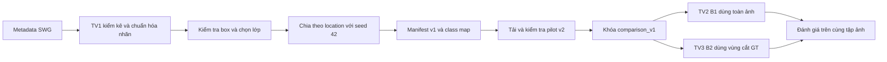
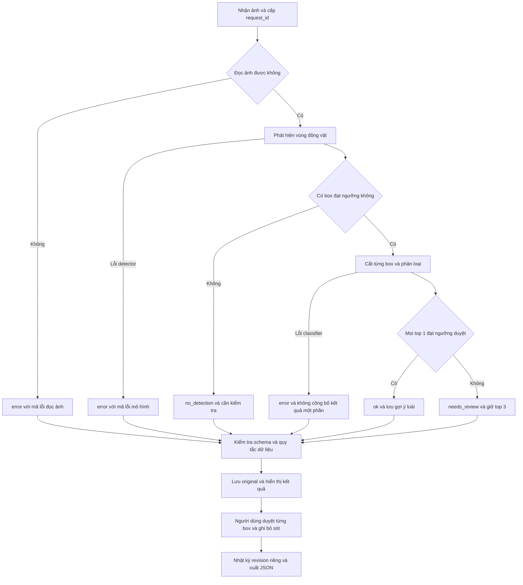

# Cấu trúc dự án và sơ đồ luồng

## Cấu trúc hiện có đến tuần 4

```text
Camera-Trap-ML/
  app/                     Web HTML/CSS/JavaScript
  src/                     Dữ liệu, mô hình, đánh giá và demo
  configs/                 Cấu hình split, model registry và model lock
  contracts/               JSON Schema cho kết quả suy luận
  coordination/            Tài nguyên và lượt đăng ký GPU
  data/processed/          v1, v2 và comparison_v1 đã khóa
  docs/                    Hướng dẫn và checklist bàn giao
  examples/results/        Kết quả giả lập cho TV2, TV3, TV4
  notebooks/               Notebook EDA
  reports/                 EDA, bàn giao từng thành viên và bằng chứng kiểm thử
  experiments/             Cấu hình và kết quả các lượt huấn luyện
  scripts/                 Demo, xử lý dữ liệu, huấn luyện và kiểm định
  tests/                   Kiểm thử tự động
  requirements.txt         Phụ thuộc của phần đã triển khai
```

Các thư mục local `data/raw`, `data/interim`, `data/images`, `.venv`, `outputs`,
`runs` không được push. `outputs` chứa weights/cache và nhật ký duyệt. Các file
trọng số `.pt/.pth/.ckpt` không đưa lên Git dù nằm trong thư mục thí nghiệm.

## Luồng dữ liệu nghiên cứu đã triển khai



comparison_v1 gồm 4.000 ảnh với split 2.800/600/600; B1/B2 dùng cùng ảnh gốc.
B2 đã khóa và đã đánh giá Test; B3 vẫn thăm dò, chưa tái lập khớp hoàn toàn.
GT boxes dùng trong đánh giá classifier khác với box do detector tạo khi chạy
demo. Nhãn thật trong manifest không đi vào demo để quyết định dự đoán.

## Luồng ứng dụng đã triển khai



`no_detection` không chứng minh ảnh trống; `ok` chỉ là đạt ngưỡng demo. Mô hình
mặc định là MDv5a.0.1 + B2, top 3 riêng từng box. Cache model trong RAM, batch
crop tối đa 8, score chưa hiệu chỉnh. B0/B1 và Giả lập vẫn dùng được cho kiểm thử.

Mỗi phiên có `inference.json` bất biến và `events.jsonl` bổ sung từng lần duyệt.
Sửa nhãn không thay original hoặc dữ liệu khóa. Điểm thấp/không rõ loài được
chuyển cần kiểm tra, không tự nhận dạng loài lạ. Xem [hợp đồng JSON](result_contract.md)
và [bàn giao TV4](handoff_tv4_w4.md).

## Ranh giới tích hợp

| Bên cung cấp | Bên nhận | Định dạng |
|---|---|---|
| TV1 | TV2 và TV3 | Manifest JSONL, class_map.json, location_split.json |
| TV2 và TV3 | TV4 | Checkpoint, preprocessing, class map/version và kết quả theo schema |
| TV4 | Giao diện và xuất file | JSON phiên duyệt cho mỗi ảnh, gồm original + review + events |
| Người kiểm tra | Nhóm | Nhận xét trên PR và checklist nghiệm thu |

Model ID, ngưỡng, ánh xạ nhãn và preprocessing đi cùng checkpoint/registry.
Web xử lý một ảnh mỗi request. Benchmark chạy tuần tự, lưu từng job có trạng
thái, phần cứng, cỡ lô và thời gian; resume không bỏ qua lỗi hoặc chạy trùng job.
