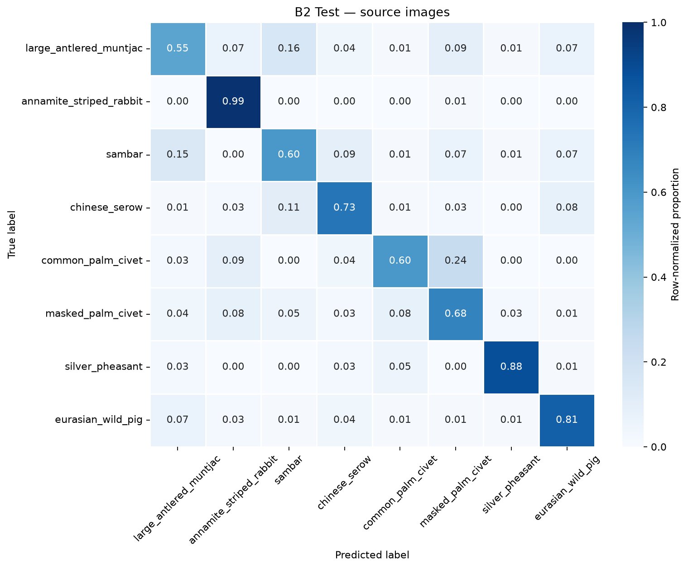

# TV2 W4-02 — official B2 Test evaluation

**OFFICIAL TEST COMPLETED. W4-02 IMPLEMENTATION COMPLETE – PENDING TV1 REVIEW.**

## Quyết định trước Test

Nhóm đã chốt B2: **YES** qua chỉ thị người dùng, ghi [decision record](w4_evidence/continuation_02/team_b2_decision.json). Final model **LOCKED – B2**, b2_run01, ResNet18 crop classifier,epoch21; SHA `8787ffaf1e56e6316a137e2f94f81b0a21608910bb3198fe6724c129242127e5` (89,548,866 bytes). Quyết định chỉ dựa Validation. B2 independent Validation Macro-F1 **0.7454765175**, CM/error IDs khớp; đây không phải Test metrics.

Lock tạo lúc `2026-10-23T06:48:53.792415+00:00`, commit trước Test **`2a750c30c43d3b895577cf53d76f2d507321ec18`**, commit time `2026-10-23T13:49:30+07:00`. Official start `2026-10-23T06:52:10.160808+00:00`, complete `2026-10-23T06:54:23.871877+00:00`. [Pre-inference receipt](w4_evidence/continuation_02/pre_inference_receipt.json) và [consistency proof](w4_evidence/continuation_02/test_consistency.json) xác minh đúng thứ tự. Không backdate. Lock SHA `dbc7ea6e60175502607561eb2ba2107ebd965fa274b7542f123347c4737fcec7`; protocol SHA `0c0b184d79167575cc18ca5bc3dfd7047d9d9799c43daa3bdf6e44d531a91b19`. Hai hồ sơ giữ nguyên byte sau khóa.

B3 exact reference reproduction vẫn **FAIL / UNRESOLVED**: reference Macro-F1 0.7410465263; CPU0.7410527052 (khác2 prediction), CUDA0.7427341579 (khác1). Original runtime/training provenance chưa đầy đủ. Nhóm chấp nhận giới hạn cho lựa chọn B2, không biến B3 thành PASS. B3 không Test; không thêm B1/B3 vào comparison. Bằng chứng FAIL và blocker lịch sử giữ nguyên. [Review TV3](TV2_REVIEW_TV3_W4.md). TV1 chưa nghiệm thu.

## Frozen protocol

Dataset comparison_v1:600 parent images /680 GT crops /495 sequences /98 locations /8 classes /75 parents mỗi lớp. Kiểm tra SHA đầy đủ600/600 trước inference và sau run; không tải lại, không sửa split/label/box. Leakage audit giữ ID/path/site/sequence/fileSHA tách biệt giữa Train/Val/Test.

CPU Python3.12.14/torch2.8.0+cpu; crop batch tối đa32,threads4,seed42. RGB không EXIF rotation; crop integer frozen boxes, padding0; resize short256 → CenterCrop224 → ImageNet normalize. model.eval(), inference_mode(), no optimizer/gradient/random augmentation. Mean vector softmax **mọi crop hợp lệ** cùng image_id rồi argmax; đúng1 prediction/parent, tie ID nhỏ nhất. Không cutoff confidence. labels0–7, zero_division0, không làm tròn trước metric, macro không trọng số, CM hàng thật/cột dự đoán. Chỉ báo classification metrics, không Test loss.

[Lock](TV2_W4_MODEL_SELECTION_LOCK.json) và [protocol](TV2_W4_EVALUATION_PROTOCOL.json) đã commit trước forward. Lock pin canonical protocol hash (bỏ reverse selection hash để tránh vòng), protocol pin full-byte selection SHA; code/evidence/data hashes và Git blobs đều kiểm tra. Gate chưa commit đã BLOCKED đúng, gate sau commit PASS. Marker độc quyền giữ nguyên, không official rerun/resume hoặc chọn metric.

## Kết quả Test thực tế

| Metric Test | Giá trị |
|---|---:|
| Macro-F1 | 0.7263366903 |
| Macro-Precision | 0.7302792835 |
| Macro-Recall | 0.7300000000 |
| Accuracy | 0.7300000000 |
| Đúng / tổng | 438 / 600 |
| Sai | 162 |

| ID | Loài | Precision | Recall | F1 | Support | Sai |
|---:|---|---:|---:|---:|---:|---:|
| 0 | large_antlered_muntjac | 0.630769 | 0.546667 | 0.585714 | 75 | 34 |
| 1 | annamite_striped_rabbit | 0.770833 | 0.986667 | 0.865497 | 75 | 1 |
| 2 | sambar | 0.642857 | 0.600000 | 0.620690 | 75 | 30 |
| 3 | chinese_serow | 0.733333 | 0.733333 | 0.733333 | 75 | 20 |
| 4 | common_palm_civet | 0.762712 | 0.600000 | 0.671642 | 75 | 30 |
| 5 | masked_palm_civet | 0.600000 | 0.680000 | 0.637500 | 75 | 24 |
| 6 | silver_pheasant | 0.929577 | 0.880000 | 0.904110 | 75 | 9 |
| 7 | eurasian_wild_pig | 0.772152 | 0.813333 | 0.792208 | 75 | 14 |

## Confusion Matrix

| True / Pred |0|1|2|3|4|5|6|7|
|---|---:|---:|---:|---:|---:|---:|---:|---:|
|0|41|5|12|3|1|7|1|5|
|1|0|74|0|0|0|1|0|0|
|2|11|0|45|7|1|5|1|5|
|3|1|2|8|55|1|2|0|6|
|4|2|7|0|3|45|18|0|0|
|5|3|6|4|2|6|51|2|1|
|6|2|0|0|2|4|0|66|1|
|7|5|2|1|3|1|1|1|61|

Tổng CM=600, support=600,75 mỗi lớp, đủ600 unique parent IDs,680 crop; metrics/CSV/journal/ma trận khớp kiểm tra độc lập. PNG biểu diễn tỷ lệ chuẩn hóa theo hàng; CSV là số đếm gốc.

## Artifact và tái lập

[test_metrics.json](w4_evidence/continuation_02/official_test/test_metrics.json), [per_class_metrics.csv](w4_evidence/continuation_02/official_test/per_class_metrics.csv), [confusion_matrix.csv](w4_evidence/continuation_02/official_test/confusion_matrix.csv), [confusion_matrix.png](w4_evidence/continuation_02/official_test/confusion_matrix.png), [evaluation_config.json](w4_evidence/continuation_02/official_test/evaluation_config.json), [evaluation_manifest.json](w4_evidence/continuation_02/official_test/evaluation_manifest.json), [checkpoint_verification.json](w4_evidence/continuation_02/official_test/checkpoint_verification.json), [test_evaluation_log.txt](w4_evidence/continuation_02/official_test/test_evaluation_log.txt), [predictions CSV](w4_evidence/continuation_02/official_test/test_predictions.csv), [journal đầy đủ vector](w4_evidence/continuation_02/official_test/progress.jsonl), [error analysis tất cả lỗi](w4_evidence/continuation_02/official_test/error_analysis.md), [environment](w4_evidence/continuation_02/official_test/environment.json), [state](w4_evidence/continuation_02/official_test/state.json). Bản copy report giữ byte/hash chính xác từ outputs/tv2_w4/W4_test_eval01; không sửa outputs gốc. Chỉ chứa biểu đồ CM, không đưa ảnh SWG/checkpoint lên Git.

Forward+softmax `46.829287s`; model load `7.049906s`; hash/decode/preprocess/inference/journal trong vòng đánh giá `117.617458s` (`5.1013` ảnh/s). Timer vòng đánh giá không gồm preflight toàn bộ600 ảnh và lần load. Không gọi đây là latency end-to-end MegaDetector hoặc benchmark TV4. Hardware/runtime ở environment artifact.

Không chạy lại official command: marker/state COMPLETE đang khóa run. Để audit dùng lệnh không --execute hoặc kiểm tra artifact hash, không forward lại Test. Lệnh đã dùng duy nhất được lưu trong receipt.

## Giới hạn

600 ảnh Test thuộc495 chuỗi và98 địa điểm, không phải600 quan sát độc lập hoàn toàn. Mỗi lớp75 ảnh, mẫu cân bằng không phản ánh tần suất loài ngoài tự nhiên. Một cặp trùng nội dung RGB cùng Test tại loc_0851 vẫn giữ nguyên (`d86f91b0-8c29-11eb-8c2e-000d3a74c7de`, `d86f91b6-8c29-11eb-94af-000d3a74c7de`); không lọc theo kết quả. Chỉ closed-set8 lớp. Ground-truth box classification không tương đương box detector dự đoán hoặc MegaDetector end-to-end demo; một số phiên bản MegaDetector đã dùng dữ liệu SWG khi huấn luyện, phải kiểm tra detector/version trước đánh giá end-to-end. Softmax chưa calibration; confidence thấp không chứng minh loài lạ. Số ảnh hoặc chuỗi không suy ra số cá thể. Phân nhóm box nhỏ/nhiều crop là mô tả quan sát, không chứng minh nguyên nhân lỗi. Không dùng lỗi Test để đổi B2, checkpoint, preprocessing, threshold hoặc nhãn.
