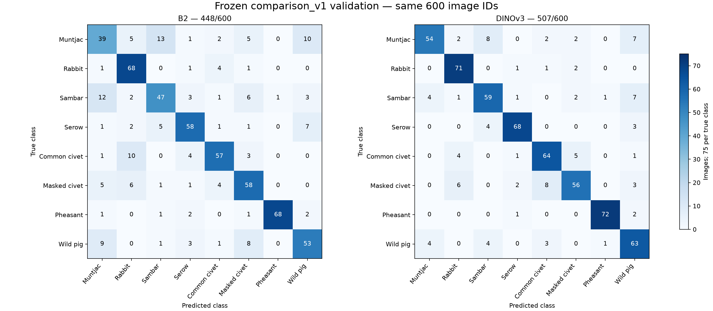

# TV2 W5 — independent DINOv3 acceptance, 02/11/2026

**Independent model acceptance PASS. ZIP/checkpoint, predictions/metrics,
original TV2 evaluator và fresh-process model replay đều PASS. W5 tổng thể
vẫn PARTIAL: chờ TV4 adapter/UI smoke, kiểm tra chéo và P2 retest.**

Đề xuất DINOv3 làm ứng viên demo sau gate TV4; giữ B2 fallback có kiểm soát.
Không thay model production, sửa nhánh TV4, train thêm, Test W4, merge PR hoặc
thực hiện W6. Đây là nghiệm thu kỹ thuật theo yêu cầu trực tiếp TV2; không
tạo chữ ký hoặc approval thay TV1/TV4/nhóm.

## 1. Nguồn và tiếp nhận

TV2 base/protocol commit `8137ef720222784bac859ab953124b4cc293f179`;
TV3 report `5734d38c3af2fe052cf04c4c33d940e8f186306d`;
training commit `aa64fd7661827af78ddec4e3e0155b2b9c87b9e2` là ancestor report.
Ba pipeline source hashes đúng source lock đã APPROVED; config và receipt
nguyên byte khớp TV2 commit. Không merge/checkout nhánh thành viên khác.

ZIP thực nhận `dino/DINOv3_LP_run01_handoff_2026-11-02.zip`,81.225.769bytes,
SHA-256 `9e969585cd7c7355733976b37bda912dd8deb2667d096ddf9193d62bbc276301`.
28 entries; CRC toàn bộ PASS; không path traversal, backslash/drive path,
symlink, encrypted entry hoặc duplicate/case collision. Set payload khớp
manifest:27/27 SHA/bytes PASS, index self kiểm với Git report. Các metadata
Git/report khớp byte; Markdown nếu có normalization được phân biệt trong intake.
Giải nén vào outputs attempt riêng; ZIP/artifact TV3 giữ nguyên.

Checkpoint `best_model.pt`: **86.851.958bytes**, SHA-256
`acbe32252af4db420b7d6be4124b5273eadd81fff59620678d1f472413c0fbc3`.
`weights_only=True` load cả best/last:190 tensors/21.618.072 elements, FP32,
hữu hạn. Best config/binding/classmap/validation đúng JSON, head[8,384]+bias[8],
epoch9; last epoch16,bad7,best_head đúng best checkpoint, scheduler T_max50.
Hash full checkpoint khác hash pretrained gốc là đúng vai trò artifact.

## 2. Gate và phép kiểm độc lập

| Gate | Kết quả | Bằng chứng |
| --- | --- | --- |
| ZIP CRC/path/duplicates/payload | PASS | intake.json,28entries/27payload |
| Checkpoint SHA/bytes/safe structure | PASS | checkpoint_inspection.json |
| Config/APPROVED protocol/source/binding/classmap/data | PASS | raw config e9303b…, serialized320718…, receipt e47b96…; source lock và metadata hashes |
| 600image/680crop saved predictions | PASS | schemas,IDs/labels/classorder,finite8-vector,counts/checkpoint/argmax/ties,mean vectors |
| Metrics/CM/per-class arithmetic | PASS | independent_metrics.json, không dùng metric TV3 làm input |
| Best9/stop16,SGD/cosine/patience | PASS | log epochs1–16,LR từng epoch đúng cosine50,7epoch không cải thiện sau9 |
| TV3 reload/auditor receipt integrity | PASS | hashes/inputs/CSV/predictions khớp; phân biệt đây là report chạy tại TV3 |
| Original TV2 evaluator chạy tại TV2 | ARTIFACT_VERIFIED | tv2_evaluator_invocation.json/log và tv2_audit.json |
| Fresh-process real model replay tại TV2 | **PASS** | independent_replay/report.json; logit delta0,0image changes; toàn object bằng nhau |
| TV4 integration + UI P2 | PENDING | tài liệu handoff, chưa có execution/approval TV4 mới |

Evaluator/module TV2 hiện tại byte-identical code auditor pin3f76643 TV3 đã
dùng. TV2 tự chạy lại trên binary/crop predictions thật; không lấy báo cáo TV3
thay kết quả độc lập. Kiểm tất cả600 image predictions và680 crop predictions,
không chỉ sample hoặc argmax. Mean vector khác tối đa
0.0 do thứ tự arithmetic, đúng gate1e-10 có
sẵn, không thay tolerance. Phép model replay dùng equality chính xác, không
nới tolerance; mọi logits, crop/image probabilities, labels và metric đều khớp.

## 3. Independent model replay thực

Lấy architecture chính thức tại commit
`6876159a11b4df116f30f667f8c9888617df0751`, checkout clean; factory SHA
`821b0f6f034fd866862d1b355036321389436fd534766829251cd4e19da2ef45`
khớp hồ sơ TV3. Full checkpoint có backbone/head, không tải pretrained gốc.
Tiến trình mới dùng source TV3 đúng training commit, `load_package` strict/
weights_only, backbone frozen/eval, CLS384 + Linear8. Source/preprocess kiểm
đúng RGB/noEXIF/integer bbox/padding0/ToImage uint8/square256 bilinear antialias/
float32 scale/ImageNet normalize.

TV2 kiểm **600/600 val source byte/RGB/dimensions** trước forward; source paths
giới hạn data/images, mọi row split=val. Trích lại680crops, batch32crops;
head đánh giá toàn680features theo đúng reference shape. Không feature cache,
không forward train/Test, không train head/backbone. Đây là native package
replay, chưa phải xác nhận adapter đã tích hợp trong app TV4.

Runtime TV2: Python3.12.14, torch2.6.0+cu124,
torchvision0.21.0+cu124,Pillow12.2.0,NumPy2.5.3,
sklearn1.9.0,CUDA12.4/cuDNN90100;
NVIDIA GeForce RTX 4060 Laptop GPU,10CPU/interop threads, FP32/AMPfalse/TF32false/deterministic.
Python minor/OS/driver được ghi thực tế, không giả môi trường đồng nhất tuyệt đối.
Môi trường replay mới riêng trong outputs, không thay môi trường CPU/CUDA cũ;
torch2.6/torchvision.21 và sklearn1.9.0 được pin để đối chiếu. Một probe import
trong lúc cài chưa hoàn tất gặp DLL thiếu; log setup còn lỗi encoding console,
install kết thúc0 và runtime thực đã kiểm trước replay. Không coi các probe
setup đó là model replay FAIL/PASS hoặc xóa dấu vết.

Kết quả: max_abs_logit_delta **0.0**,
crop probability delta **0.0**,
image probability delta **0.0**,
prediction changes **0**; full predictions
and metrics exact. Trích đặc trưng/head 73.042s,
tổng gồm pixel gate/load/eval 263.133s;
peak allocated299596288bytes,
reserved402653184bytes. Đây là một fresh replay,
không benchmark cold/warm UI hay lời hứa latency webcam. Lệnh đầy đủ/source
runner và log được lưu trong evidence mới.

## 4. B2 so với DINOv3 — cùng600 image_id

| Metric | B2 | DINO TV2 arithmetic | Delta DINO−B2 |
| --- | ---: | ---: | ---: |
| Accuracy | 0.7466666666666667 | 0.845 | +0.09833333333333327 |
| Macro-F1 | 0.7454765175212033 | 0.8444008279545706 | +0.09892431043336736 |
| Macro-precision | 0.7484190016985997 | 0.8479570314127788 | +0.09953802971417913 |
| Macro-recall | 0.7466666666666667 | 0.845 | +0.09833333333333327 |
| Đúng/tổng | 448/600 | 507/600 | +59ảnh |

Accuracy tăng **9,8333 điểm phần trăm**, macro-F1 tăng **9,8924 điểm phần trăm**.
TV3 sklearn macro-F1 `0.8444008279545705`; arithmetic TV2 ra tận cùng6, chênh
~1e-16 được giữ nguyên. Không sửa reference hoặc làm tròn để giả exact replay.

| Ghép cặp từng ID | Ảnh |
| --- | ---: |
| B2 đúng / DINO sai | 36 |
| B2 sai / DINO đúng | 95 |
| Cả hai đúng | 412 |
| Cả hai sai | 57 |

Đủ600ID, cùng ground truth và checkpoint B2 khóa8787ffaf…2127e5. Error IDs,
scores/crop counts và paired lists đầy đủ trong independent_metrics/error_cases.

| ID | Class | B2 F1 | DINO P | DINO R | DINO F1 | ΔF1 điểm % | Support |
| --- | --- | ---: | ---: | ---: | ---: | ---: | ---: |
| 0 | large_antlered_muntjac | 0.541667 | 0.870968 | 0.720000 | 0.788321 | +24.665 | 75 |
| 1 | annamite_striped_rabbit | 0.809524 | 0.845238 | 0.946667 | 0.893082 | +8.356 | 75 |
| 2 | sambar | 0.657343 | 0.786667 | 0.786667 | 0.786667 | +12.932 | 75 |
| 3 | chinese_serow | 0.783784 | 0.918919 | 0.906667 | 0.912752 | +12.897 | 75 |
| 4 | common_palm_civet | 0.786207 | 0.820513 | 0.853333 | 0.836601 | +5.039 | 75 |
| 5 | masked_palm_civet | 0.734177 | 0.835821 | 0.746667 | 0.788732 | +5.456 | 75 |
| 6 | silver_pheasant | 0.944444 | 0.972973 | 0.960000 | 0.966443 | +2.200 | 75 |
| 7 | eurasian_wild_pig | 0.706667 | 0.732558 | 0.840000 | 0.782609 | +7.594 | 75 |

CM8×8 đầy đủ và số liệu gốc:
[B2 CSV](w5_acceptance/2026-11-02/attempt_01/b2_confusion_matrix.csv),
[DINO CSV](w5_acceptance/2026-11-02/attempt_01/dino_confusion_matrix.csv),
[per-class figure](w5_acceptance/2026-11-02/attempt_01/per_class_f1.png).

**Lỗi còn yếu cần bàn giao:**

- Muntjac↔sambar giảm25→12 nhầm trực tiếp:0→2 giảm13→8,2→0 giảm12→4.
  Muntjac vẫn sai21/75, recall.72; sambar sai16/75. Cả hai tiếp tục nhầm wild
  pig7ảnh mỗi lớp; sambar→pig tăng3→7 dù tổng sambar tốt hơn.
- Hai civet nhầm trực tiếp **tăng7→13**:common→masked3→5,masked→common4→8.
  Masked-civet đúng **58→56/75**, recall.773333→.746667; F1 vẫn tăng vì precision
  tăng. Có10ảnh masked-civet B2 đúng/DINO sai, chỉ8ảnh chiều sửa được.
  Không che regression bằng macro-F1 tăng. Common-civet đúng57→64/75, F1 tăng.
- Wild-pig precision thấp nhất.732558,F1.782609; còn4ảnh pig→muntjac,
  4ảnh pig→sambar. Các lớp pheasant/rabbit/serow có F1 cao hơn nhưng không
  chứng minh chuyển miền hoặc chất lượng detector/webcam.

Các mẫu nhầm trên là quan sát từ GT/predictions, chưa có semantic review ảnh
hoặc bằng chứng nguyên nhân. Không quy cho che khuất/nhãn sai/thiếu dữ liệu
chuyên gia khi chưa kiểm. Không đổi checkpoint/threshold/hyperparameter theo
Test; không mở seed/lượt mới hoặc dùng1665ảnh mở rộng chưa release.

## 5. Kết luận demo, W5 và bước tiếp

Đủ bằng chứng **independent model acceptance PASS** theo protocol validation.
Đề xuất DINOv3 làm **ứng viên demo**, giữ B2 fallback có kiểm soát. Chưa thay
backend production hoặc xác nhận adapter/UI TV4; TV4 phải kiểm class/preprocess/
per-box IDs/top3, lỗi/fallback tường minh, native-adapter equivalence và runtime
thực. Chi tiết [handoff TV4](../../docs/handoff_tv2_dino_w5_to_tv4.md).

**W5 tổng thể vẫn PARTIAL:** phần model TV2 đã nghiệm thu PASS, còn kiểm adapter
cùng TV4, P2UI-A11Y-01 fix/retest và xác nhận delivery/reviewer review. PR/comment
trước từng bị connector403; lần này chỉ chuẩn bị tài liệu, không giả đã gửi.
Không biến việc chưa tích hợp TV4 thành blocker model replay đã PASS, và không
coi acceptance TV2 là approval TV4 hoặc nghiệm thu W6.

Chưa đạt88% (84,5% validation), chưa có Test DINO độc lập, một seed/một lượt,
GT-box metric không phải detector+classifier/webcam; khác architecture/pretrain/
preprocessing/recipe nên không tách riêng nguyên nhân cải thiện. Không train
thêm, chạy Test W4, sửa B2/dataset/receipt cũ hoặc merge PR. Artifact gốc giữ
nguyên; mọi phép kiểm mới có attempt/log/hash riêng.
