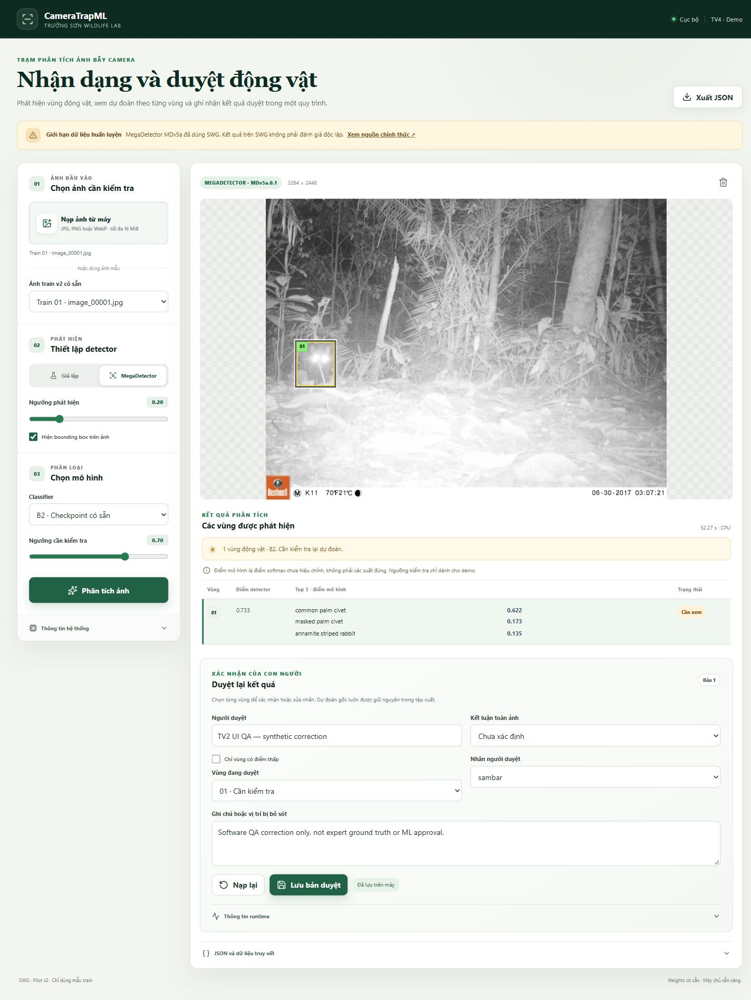

# TV2 W5 independent review of TV4 PR 8

## Cập nhật độc lập ngày 30/10/2026

**Functional UI PASS với một finding P2 về accessibility; chưa APPROVE/merge PR.**
Review đúng head `fef2511b571b23be3d4e2cf6c1ccedd659097b6f`, snapshot code
không sửa (đối chiếu Git, chỉ CRLF conversion đã ghi hash). Server ngoài sandbox
trên localhost8768 đã giải quyết blocker kết nối browser trước đó. Journal QA
mới nằm riêng trong `outputs/tv2_w5/ui_review_20261030_01/sessions/`, không sửa
checkpoint/nhánh TV4 hoặc các receipt cũ. Browser là in-app Chromium; screenshot
và JSON thực trong `w5_ui_review/2026-10-30/attempt_01/`.

| Test case mới | Expected / Actual | Kết quả |
| --- | --- | --- |
| UI30-01 real B2 | MegaDetector+B2 thật trên mẫu0train;1box,top3,status needs_review,không fallback | PASS |
| UI30-02 responsive |1440×1100,390×844,320×740;không tràn ngang,box trong ảnh | PASS |
| UI30-03 nhiều box/resize | Synthetic2box đúng nhãn giả lập;tọa độ sau resize ở3kích thước,sai lệch tối đa<0,011px | PASS |
| UI30-04 row→box | Click hàng2 chọn đúng review-box/selected row/box theo detection_id | PASS |
| UI30-05 box→row | Click overlay1 chọn đúng hàng/vùng1 | PASS |
| UI30-06 lọc điểm thấp | Fixture2box thấp giữ đủ2options,không mất ID | PASS |
| UI30-07 draft | Đổi nhãn/note hiển thị Có thay đổi chưa lưu | PASS |
| UI30-08 save | Revision0→1,original giữ nguyên;correction có nhãn software QA,không phải expert GT | PASS |
| UI30-09 reload | Đổi note chưa lưu rồi Nạp lại;khôi phục đúng saved revision/note | PASS |
| UI30-10 export | Click browser download;JSON tải về deep-equal saved session,original bất biến | PASS |
| UI30-11 upload | File chooser nạp ảnh train có hash;filename/preview/kết quả mock đúng | PASS |
| UI30-12 ảnh hỏng | Upload synthetic_corrupt.jpg;status error/error.stage read,không output một phần | PASS |
| UI30-13 no_detection | Fixture0box,label review disabled,UI nói không đồng nghĩa ảnh trống | PASS |
| UI30-14 detector miss | Ghi quyết định riêng/revision,note synthetic;original no_detection không bị đổi | PASS |
| UI30-15 detector error | Fixture lỗi detector có status error và hướng dẫn rõ,không silent fallback | PASS |
| UI30-A11Y-01 | Nút export mobile cần accessible name | **FAIL/P2**,xem dưới |

Kết quả raw: [verification.json](w5_ui_review/2026-10-30/attempt_01/verification.json),
[selection mapping](w5_ui_review/2026-10-30/attempt_01/selection_mapping.json),
[responsive multiple](w5_ui_review/2026-10-30/attempt_01/responsive_multiple_geometry.json),
[browser export](w5_ui_review/2026-10-30/attempt_01/browser_exported_session.json).
Browser console errors/warnings rỗng trong lượt này. Counter ban đầu
invalidReviewFields=1 gồm checkbox16px có chủ đích; audit sửa điều kiện để chỉ
đo input/select/textarea dùng nhập liệu, tất cả nằm trong viewport. Giữ cả hai
audit, không coi kích thước checkbox là bug responsive.

Ảnh thực đã quan sát độc lập:

[Mobile390](w5_ui_review/2026-10-30/attempt_01/mobile_390_real_reviewed.jpg),
[mobile320](w5_ui_review/2026-10-30/attempt_01/mobile_320_real_reviewed.jpg),
[hai box synthetic](w5_ui_review/2026-10-30/attempt_01/desktop_synthetic_multiple.jpg),
[ảnh hỏng](w5_ui_review/2026-10-30/attempt_01/desktop_corrupt_error.jpg).

### Finding P2 UI-A11Y-01 — owner TV4

Tại320/390px, CSS ẩn span “Xuất JSON”, nút chỉ còn icon. DOM không có
`aria-label` hoặc `title`; AX tại mobile hiển thị nút export không có tên đọc.
Nút vẫn click/download được nên không chặn chức năng export; screen reader
không nhận được mục đích rõ ràng. [DOM evidence](w5_ui_review/2026-10-30/attempt_01/mobile_export_accessibility.json).

Tái hiện: mở đúng headPR8 với kết quả đã chạy → viewport320px hoặc390px →
kiểm AX nút export; `innerText=''`,span display none,aria-label/title null.
Expected: nút icon vẫn có accessible name “Xuất JSON”. TV4 sửa nhãn truy cập
trên nhánh của họ; TV2 retest AX/mobile download cùng checkpoint/fixtures.
Không tự sửa app hoặc APPROVE PR8 trong lượt TV2 này. Không có findingP0/P1.

### Runtime và kiểm thử mới

B2 thật chạy trên CPU i7-13620H/RAM15,71GiB,4threads,ảnhbatch1,
maxcropbatch8,actual1crop. UI ghi52,27s cho cold request khi đang khởi tạo model
và gần thời điểm regression; không dùng làm benchmark đại diện hoặc so DINO.
Runtime/raw timings ở real_initial.json. Không có validation metric mới.

Regression mới **409PASS/0FAIL/0SKIP**,64,740s unittest; snapshotTV4
**44PASS/0FAIL/0SKIP**,8,393s. Environment và6contract fixtures PASS. Logs trong
`w5_pretrained_review/2026-10-30/attempt_01/`. CSV/batch chưa triển khai trong
PR8, không ép nghiệm thu ngoài phạm vi. Mọi nhãn sửa là QA synthetic riêng,
không là training GT. Không chạy DINO hoặc Test W4.

## Lịch sử review 28–29/10/2026 — giữ nguyên bằng chứng

**PARTIAL — API verified; browser/UI acceptance BLOCKED.** Thực hiện
28–29/10/2026 (giờ Việt Nam). PR
[#8](https://github.com/huyryan220806/Camera-Trap-ML/pull/8) đang mở, chưa merge.
Head được review: **`fef2511b571b23be3d4e2cf6c1ccedd659097b6f`**, UI code commit
tham chiếu `0179d97` được đối chiếu qua diff. Không sửa/push nhánh TV4.

## Môi trường và nguồn chứng cứ

Snapshot riêng từ Git archive trong `outputs/tv2_w5/attempt_01/upstream/tv4`.
API QA đối chiếu nội dung10 file app/server/adapter/registry với `git show`
đúng head; Windows archive có CRLF conversion ở text web, ghi cả hash bản Git
và archive trong [snapshot.json](w5_evidence/attempt_01/ui_api_03/snapshot.json).
Không lấy trạng thái PASS của tác giả làm kết quả TV2.

Windows11, Intel i7-13620H/16 logical CPUs, RAM15,71GiB, Python3.12.14,
torch2.8.0+cpu/torchvision0.23.0, MegaDetector10.0.25; CPU4threads. Checkpoint
B2 thật SHA `8787ffaf1e56e6316a137e2f94f81b0a21608910bb3198fe6724c129242127e5`;
MDv5a.0.1 local đã đối chiếu checksum; bản copy trong snapshot, không thay
weights sản xuất TV4. Tám mẫu train copy từ nguồn khóa/hash, chỉ mẫu0 được
suy luận cold/warm. Fixture mock/ảnh hỏng được ghi nhãn rõ, không phải GT.

Lệnh: `scripts/review_tv4_w5.py --snapshot <snapshot> --commit fef2511b571b23be3d4e2cf6c1ccedd659097b6f --url http://127.0.0.1:8767 --output outputs/tv2_w5/attempt_01/ui_api_03`.
[Log](w5_evidence/attempt_01/ui_api_03.log),
[command/time](w5_evidence/attempt_01/ui_api_03.command.json),
[summary](w5_evidence/attempt_01/ui_api_03/review_summary.json).
**15 assertions API PASS**; **44/44 unittest TV4 PASS**,0FAIL/0SKIP,
8,534s: [log](w5_evidence/attempt_01/tv4_tests_02.log).

## Expected versus actual

| Case | Expected | Actual | State / evidence |
| --- | --- | --- | --- |
| A01 ảnh đơn, B2 thật | Không fallback; top3/box đúng ID | Cold/warm mỗi lượt1 box, needs_review, classifier B2, pipeline inference | PASS API, real_cold/real_warm JSON |
| A02 nhiều box | Detections riêng và review đúng detection_id | Fixture synthetic2 box, IDs duy nhất/đầy đủ, needs_review | PASS API, synthetic_multiple.json |
| A03 chọn box/hàng | Click đồng bộ vùng duyệt và highlight | Static code có detection_id handlers; chưa click trong browser | BLOCKED browser |
| B01 1440×1100 | Không tràn/box đúng tọa độ | Không có screenshot TV2 | BLOCKED |
| B02 390×844 | Như trên | Không có screenshot TV2 | BLOCKED |
| B03 320×740 | Như trên | Không có screenshot TV2 | BLOCKED |
| C01 needs_review/low score | Không đổi thành loài lạ | Real score dưới ngưỡng demo và mock needs_review được giữ | PASS API; UI wording chưa quan sát trực tiếp |
| C02 không box/no_detection | Giữ0box, review riêng | Synthetic empty có0box/no_detection | PASS API |
| C03 ảnh hỏng | Lỗi đọc rõ, không dự đoán một phần | synthetic_corrupt.jpg: status error, error.stage read | PASS API |
| C04 detector bỏ sót | Ghi nhận riêng, không đổi original | Synthetic empty → image_outcome detector_miss/revision1, original no_detection | PASS API; không phải bỏ sót thực đã chuyên gia xác nhận |
| C05 detector lỗi | Error riêng | Fixture synthetic error giữ error/0box | PASS API |
| D01 sửa nhãn | Không ghi đè dự đoán gốc | Original deep-equal sau save; revision tăng0→1 | PASS API, reviewed_session.json |
| D02 reload | Giữ bản duyệt đã lưu | GET review bằng đúng saved session | PASS API, reloaded_session.json |
| D03 stale revision | Từ chối ghi đè | HTTP409 | PASS API |
| D04 browser JSON export/reload | Download đúng saved session; draft không giả thành saved | API JSON đã đối chiếu; chưa click export/reload browser | BLOCKED browser |
| E01 diễn giải | Score chưa calibrated; không end-to-end accuracy | API scores_calibrated=false, training_overlap_swg=true; warning source đúng | PASS API/static; browser presentation BLOCKED |
| F01 timing | Runtime/cold/warm/batch/threads thật | Hai request cùng1 ảnh train, cấu hình bên dưới | PASS trong phạm vi2 request |
| G01 batch/CSV | Chỉ kiểm khi đã triển khai | PR8 chỉ UI; chưa có batch/CSV | NOT_IMPLEMENTED; không chặn riêng phạm vi PR8 |

Ảnh/log của TV4 lịch sử không được tái sử dụng làm screenshot độc lập W5.
Không có screenshot mới vì browser chưa truy cập được. In-app browser trả
`net::ERR_CONNECTION_TIMED_OUT` với localhost8766; quyền điều khiển Edge native
trả `Computer Use app approval timed out`. Không đánh dấu UI PASS.

## Tốc độ quan sát

| Phase | Mẫu | Detections/crops | Cache B2 | Inference wall | HTTP wall |
| --- | --- | --- | --- | --- | --- |
| cold | train sample0 | 1/1 | miss | 11,713562s | 11,887630s |
| warm | cùng train sample0 | 1/1 | hit | 2,038520s | 2,154707s |

Batch ảnh1/detector1, max crop batch8, actual crop batch `[1]`, detector size1280,
classifier224, CPU4threads, không GPU. Inference wall gồm decode+detector+
classifier+hash/cache, loại upload/preview/journal/browser/human review. HTTP
wall gồm overhead API. N=1 ảnh/2request không đại diện mọi máy hoặc phân phối
tốc độ. [Runtime raw](w5_evidence/attempt_01/ui_api_03/runtime_measurements.json).

## Hồ sơ bàn giao và kiểm tra lại

Không có P0/P1/P2 **lỗi sản phẩm đã tái hiện** trong phần API. Browser timeout
là blocker môi trường review, không phải lỗi TV4 đã chứng minh. Mức ưu tiên
bàn giao: P1 acceptance blocker cho phần UI, owner TV2 + người cấp quyền chạy
browser; TV4 hỗ trợ retest trên cùng SHA. Không tự mở issue khẳng định bug UI.

Tái hiện blocker: chạy server local trên8766, mở URL bằng in-app browser;
tool timeout. Chọn cửa sổ Edge native đã có → app approval timeout. Thử API
khác network context cũng timeout; lần thành công tự mở server và client
trong cùng context ngoài sandbox. Giữ các attempt thất bại, không ghi đè log.

Điều kiện retest: browser truy cập được đúng server/snapshot, dùng B2 thật+
fixtures đã ghi nhãn; kiểm1440/390/320, tọa độ overlay khi resize, click hàng/
box thứ2, draft/save/reload/export JSON, ảnh lỗi/no-box. Lưu screenshot/log mới.
Nếu phát hiện bug, TV2 ghi bước tái hiện và severity, gửi TV4 sửa trên nhánh họ.
**Chưa APPROVE/merge PR8**; API PASS không thay thế nghiệm thu UI.
