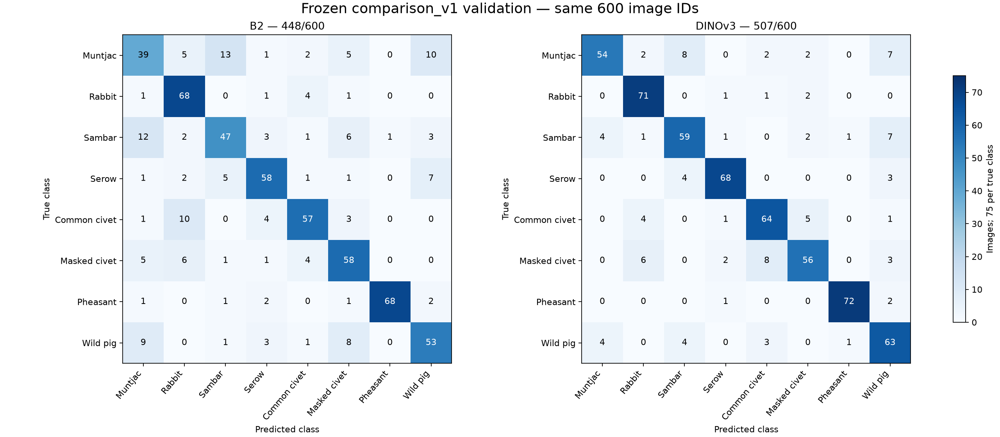

# Thực nghiệm W5: B2 và DINOv3 trên vùng cắt GT

Cập nhật02/11/2026. DINOv3_LP_run01 đã huấn luyện và **TV2 independently
accepted PASS**: integrity, dự đoán/metric và fresh-process model replay thật.
W5 tổng thể còn PARTIAL vì adapter/UI TV4 và kiểm tra chéo chưa hoàn tất.
Nguồn đầy đủ: [nghiệm thu DINO](TV2_W5_DINO_ACCEPTANCE_2026-11-02.md),
[protocol](W5_PROTOCOL.md), [raw evidence](w5_acceptance/2026-11-02/attempt_01/acceptance.json).
Không có Test DINO hoặc huấn luyện mới do TV2 thực hiện.

## Dữ liệu và thiết kế

Frozen comparison_v1: train2800 parent/3125 GT crops; validation600 parent/680
GT crops,8class ID0–7,75ảnh/lớp. Train/val cùng release của B2, crop integer
XYXY khóa,padding0,cùng image_id và class order; parent/sequence/location không
giao theo metadata gate. Lần này600val source được kiểm byte/RGB/dimensions
trước forward. Không dùng1665ảnh mở rộng chưa release, Test W4 hoặc holdout mới.
Nhãn từ metadata SWG cấp chuỗi, chưa có expert/near-duplicate audit mới.

B2: ResNet18 pretrained ImageNet1K_V1, fine-tune GT crops; validation Resize
short256→CenterCrop224→ImageNet normalize. Checkpoint epoch21/SHA8787ffaf…2127e5
đã được TV2 kiểm fresh-process/native-adapter trước; không train lại.
DINOv3: ViT-S/16 pretrained LVD-1689M, upstream6876159…,frozen backbone/eval,
CLS384→Linear8. RGB/crop→ToImage uint8→square256 bilinear antialias→float32
scale→ImageNet normalize, không random augmentation. Chỉ3080 tham số head học;
feature extraction32crops/shard128 khác optimizer batch32parents.

Protocol APPROVED8137ef7 đã khóa trước training; seed42,tối đa1run/50epochs,
patience7,SGDlr.01/momentum.9/WD.0001,cosineT_max50,FP32/AMP-TF32false.
Loss mean CE crops mỗi parent rồi mean parents,giữ batch cuối16; không cân
trọng số parent lần hai. Macro-F1 ảnh chọn checkpoint, hòa epoch sớm nhất.
DINO best epoch9,dừng16 sau7epoch không cải thiện; log/LR/safe last checkpoint
đối chiếu đầy đủ. Ngân sách1 đã sử dụng, không có seed/trial mới được cho phép.

Softmax từng crop→mean vector theo parent image_id→argmax, hòa class ID thấp
nhất. Không lọc confidence/chọn crop. Metric chính macro-F1, phụ accuracy top1,
macroP/R và per-class P/R/F1/support; zero_division0,CM rows=true/columns=predicted.

## Kết quả validation cùng600 image_id

| Model | Kiểm chứng | Đúng | Accuracy | Macro-F1 | Macro-P | Macro-R |
| --- | --- | ---: | ---: | ---: | ---: | ---: |
| B1 full-image | Validation lịch sử,không replay lần này | 339/600 | .5650000000 | .5624506868 | lịch sử | lịch sử |
| B2 GT crops | TV2 reference đã kiểm,metric tính lại lần này | 448/600 | .7466666667 | .7454765175 | .7484190017 | .7466666667 |
| DINOv3 frozen LP | TV2 artifact audit + fresh model replay thật | 507/600 | .8450000000 | .8444008280 | .8479570314 | .8450000000 |

DINO tăng59ảnh đúng:accuracy+9.8333điểm%,macro-F1+9.8924điểm%.
95ảnh B2 sai/DINO đúng;36ảnh B2 đúng/DINO sai;412cùng đúng;57cùng sai.
Không suy ra DINO tốt hơn trên mọi ảnh hoặc recall mọi lớp. Số liệu gốc không
làm tròn và paired IDs được giữ trong independent_metrics.json/error_cases.json.
Sklearn TV3 macro-F1.8444008279545705 so với arithmetic TV2.8444008279545706
khác~1e-16; không sửa reference. Fresh-process TV2 dùng native sklearn khớp
chính xác toàn object reference, không nới tolerance.

| Class | B2 F1 | DINO F1 | DINO đúng/75 |
| --- | ---: | ---: | ---: |
| large_antlered_muntjac | .541667 | .788321 | 54 |
| annamite_striped_rabbit | .809524 | .893082 | 71 |
| sambar | .657343 | .786667 | 59 |
| chinese_serow | .783784 | .912752 | 68 |
| common_palm_civet | .786207 | .836601 | 64 |
| masked_palm_civet | .734177 | .788732 | 56 |
| silver_pheasant | .944444 | .966443 | 72 |
| eurasian_wild_pig | .706667 | .782609 | 63 |

Per-class P/R/support và CM8×8 đầy đủ trong báo cáo nghiệm thu/CSV. Tất cảF1
cao hơn, nhưng masked-civet đúng58→56/75,recall giảm.773333→.746667.
Common↔masked civet nhầm trực tiếp7→13 (common→masked3→5,masked→common4→8).
Muntjac↔sambar giảm25→12 (13→8,12→4),nhưng muntjac recall chỉ.72 và mỗi lớp
muntjac/sambar còn7ảnh dự đoán wild-pig. Wild-pig precision.732558 là thấp nhất.
Đây là các mẫu nhầm được quan sát, chưa chứng minh nguyên nhân thị giác/nhãn.

## Tái lập và tài nguyên

Checkpoint DINO86.851.958bytes/SHAacbe3225…0fbc3,training commit aa64fd7,
report5734d38. TV2 kiểm28ZIPentries/27payload CRC/paths/hash,receipt/config/
source/binding/classmap/preprocess,checkpoint weights_only và last checkpoint.
Original TV2 evaluator tính lại metrics từ crop predictions thật và nhận
ARTIFACT_VERIFIED. Báo cáo reload TV3 được kiểm integrity nhưng không thay
replay độc lập: tiến trình TV2 mới load strict thực,backbone frozen/eval,
trích lại680crop không cache,head eval shape680 như reference.

TV2 replay: Python3.12.14,torch2.6.0+cu124,torchvision.21.0+cu124,Pillow12.2,
NumPy2.5.3,sklearn1.9.0;RTX4060Laptop8GB,10CPU/interop threads,FP32/deterministic.
Vendor chính thức đúng pin/clean. Môi trường riêng,môi trường cũ giữ nguyên.
Kết quả exact logits/crop+image probabilities/predictions/metrics;
max_abs_logit_delta0,0image changes. Trích feature/head73.042s,tổng263.133s
bao gồm hash/RGB/load/eval;peak allocated299596288bytes. Một fresh validation
run không phải benchmark UI cold/warm/webcam. B2 reference CPU/recipe khác,
không so latency hoặc ngân sách compute tương đương từ các con số này.

B2 inference tái lập đã PASS nhưng checkpoint B2 thiếu original training log
và embedded run_id/git_commit; không biến kiểm định suy luận thành đầy đủ
training provenance. B3 tham chiếu cũ vẫn unresolved,không đưa vào bảng đã
nghiệm thu. Mọi checkpoint B0–B3 và dữ liệu giữ nguyên.

## Phạm vi kết luận và bàn giao

DINOv3 là ứng viên demo có cải thiện rõ trên validation frozen và kiểm định
model độc lập PASS. TV4 phải kiểm loader/adapter riêng,classmap/preprocess,
per-box logits/top3/IDs,lỗi/fallback tường minh và runtime/UI thực trước lựa
chọn production; B2 giữ fallback có kiểm soát. Không trỏ loader ResNet vào
checkpoint DINO hoặc gộp box demo theo quy tắc parent GT validation.

Chưa đạt mục tiêu88% (84.5%),chưa có Test DINO độc lập,không chứng minh nhiều
seed/SOTA/chuyển miền/calibration. Khác architecture/pretraining/preprocess/
recipe nên không quy toàn bộ cải thiện cho kiến trúc. Metric GT-box không là
chất lượng MegaDetector+classifier/webcam; MegaDetector có SWG trong pretraining.
W5 PARTIAL chờ TV4 adapter/cross-review/P2retest và delivery/reviewer review;
không merge PR hoặc thực hiện W6 trong công việc này.
