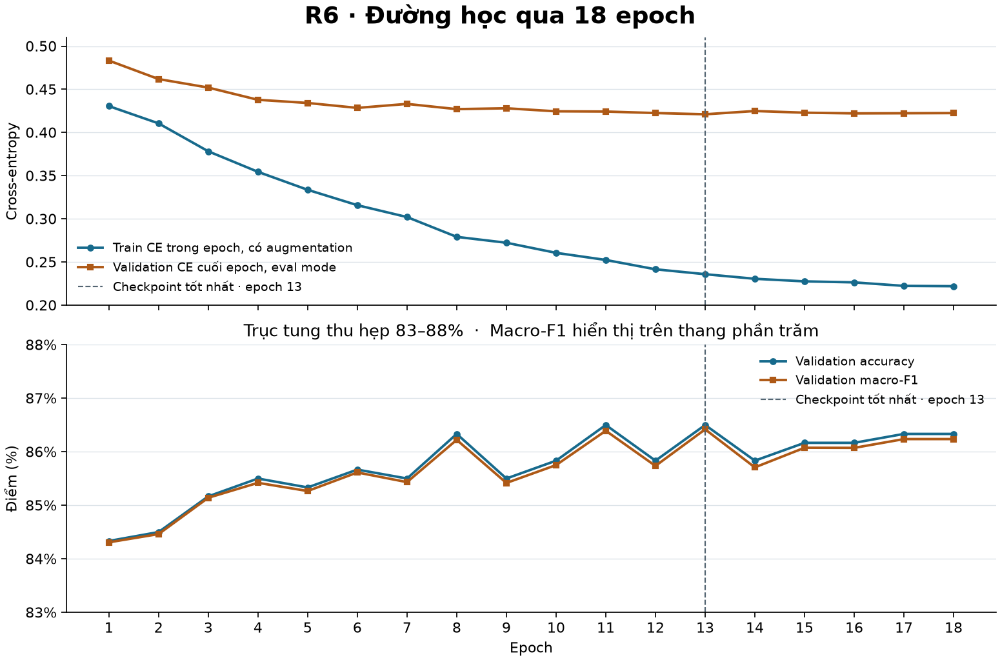

# Kiểm định TV2 W6 · Đường học và phép đánh giá R6

Ngày 13/11/2026 · `R6_attempt01` · seed 43 · recipe R2

**Quyết định `KEEP_R6` cho báo cáo ngày 14/11.** Giữ checkpoint epoch 13 với **519/600 ảnh Validation đúng (86,5%), macro-F1 0,8641867348386344**. Còn thiếu 9 ảnh đúng để đạt mục tiêu 88%. Đối chiếu mã, checkpoint, dự đoán và manifest chưa phát hiện lỗi thực thi có bằng chứng trong phạm vi rà soát. Kết quả Validation có độ chắc chắn cao nhờ đối chiếu độc lập ở mức artifact và replay TV2 ngày 10/11. Độ lớn khoảng cách Train–Validation trong cùng eval mode vẫn chờ phép đo mới.

## Nguồn và phạm vi

- Git sau fetch ngày 13/11 có `HEAD` và `origin/feat/baseline` cùng ở `96d202563c63b47d4d3d6773c3d4b5a2a29c3c7a` trước commit audit. Lấy artifact TV3 bằng Git blob từ commit bàn giao, đối chiếu SHA-256 với bản nhận local và index gói. Hai checkpoint nằm trong gói local đã được TV2 nghiệm thu. [Commit TV3 và thư mục artifact](https://github.com/huyryan220806/Camera-Trap-ML/tree/450f15bde6899faffac3c9389156d04c15196568/reports/tv3/w6/results/R6_attempt01).
- Đã đọc đủ 18 epoch trong `train_log.json`, toàn bộ dữ liệu có cấu trúc trong `validation.json`, các JSONL crop/ảnh, class map, confusion matrix, frozen config, preprocessing, handoff, binding, source index, runtime, registry kết quả, usage, reload TV3 và [báo cáo replay TV2 ngày 10/11](../TV2_W6_R6_INDEPENDENT_MODEL_REPLAY_2026-11-10.md). Đã đối chiếu cả 12 file source trong index với commit nguồn `3b4b106c01e64901f213f6eebfdd10ffa55a7eb7`, blob bàn giao và gói local. Hai file triển khai đang có trên TV2 cũng trùng byte. Mã R6 nằm ở [dino_w6.py](../../../src/training/dino_w6.py) và dùng [dino_probe.py](../../../src/training/dino_probe.py). [Frozen config](../../../configs/w6/tv3/R6.3h.frozen.json).
- Đã đọc báo cáo dữ liệu TV1 từ `origin/main` (`bda4eaa6bbc185420680ab00887dddb7b74b88dd`), cũng có trên `origin/feat/metadata-split`. `docs/reports/2026-11-13/noi_dung_bao_cao_6_trang.md` và tài liệu riêng `TV2_KIEM_TRA_GAP_DUONG_HOC_R6.md` có trạng thái `SOURCE_NOT_FOUND` trong workspace và các ref đã fetch. Nội dung yêu cầu chi tiết đính kèm được dùng để thực hiện đợt kiểm tra. [Báo cáo TV1](https://github.com/huyryan220806/Camera-Trap-ML/blob/bda4eaa6bbc185420680ab00887dddb7b74b88dd/reports/tv1_w6/REPORT.md).
- Đã đọc cơ chế eval/autograd và hướng dẫn về tái sử dụng tập đánh giá. `eval()` chuyển chế độ module, còn `inference_mode()` tắt theo dõi autograd trong khối suy luận. Việc chọn epoch và so nhiều recipe trên cùng Validation có thể làm ước lượng tổng quát hóa lạc quan. [PyTorch Module.eval](https://docs.pytorch.org/docs/2.15/generated/torch.nn.Module.html#torch.nn.Module.eval), [PyTorch inference_mode](https://docs.pytorch.org/docs/2.15/generated/torch.autograd.grad_mode.inference_mode.html), [scikit-learn Cross-validation](https://scikit-learn.org/stable/modules/cross_validation.html), [scikit-learn Nested vs. non-nested cross-validation](https://scikit-learn.org/stable/auto_examples/model_selection/plot_nested_cross_validation_iris.html).

## Đường học và early stopping

| Epoch | Train loss | Validation CE | Accuracy | Macro-F1 | Số epoch liên tiếp chưa vượt best |
| ---: | ---: | ---: | ---: | ---: | ---: |
| 1 | 0,430585 | 0,483298 | 0,843333 | 0,843085 | 0 |
| 11 | 0,252410 | 0,424278 | 0,865000 | 0,863925 | 0 |
| **13** | **0,235910** | **0,421107** | **0,865000** | **0,864187** | **0** |
| 18 | 0,222018 | 0,422491 | 0,863333 | 0,862369 | 5 |

Các điểm lấy từ log gốc và được lưu với độ chính xác đầy đủ trong [audit_evidence.json](audit_evidence.json). Trục metric Validation thu hẹp 83–88%. Epoch 11 và 13 cùng 519 ảnh đúng, nhưng macro-F1 epoch 11 là 0,8639247144128168, thấp hơn epoch 13. Kiểm tra trên CPU xác nhận `best_model.pt` ghi epoch 13, các tensor bằng `best_state` trong `last_model.pt`, và lịch sử trong checkpoint cuối trùng log. Config cho tối đa 20 epoch, patience 5, chỉ reset bộ đếm khi macro-F1 tăng nghiêm ngặt và giữ epoch sớm nếu hòa. Epoch 14–18 đều dưới đỉnh, checkpoint cuối ghi `epoch=18`, `best_epoch=13`, `bad_epochs=5`. Lượt official hoàn thành trong 8.117,31 giây, dưới trần 3 giờ.

R6 fine-tune từ backbone **và head** của R0 đã có trọng số, với hai block cuối, final norm và head được cập nhật. Train loss là trung bình CE theo ảnh trong lúc trọng số thay đổi qua các batch, với lật ngang ngẫu nhiên xác suất 0,5 theo crop. Validation CE được đo sau lượt cập nhật cuối epoch, ở eval mode, với ảnh không augmentation. Hai chuỗi dùng cùng nguyên tắc trọng số ảnh nhưng khác tập dữ liệu, trạng thái trọng số và điều kiện đo.

Validation CE giảm khoảng 0,0622 từ epoch 1 đến 13, rồi nằm trong khoảng 0,4211–0,4249 ở epoch 13–18. Accuracy cuối dao động 85,83–86,50%; epoch 18 kém epoch 13 một ảnh đúng. Đây là dấu hiệu bão hòa trên tập Validation hiện tại. Train và Validation đến từ lần lượt 540 và 102 địa điểm không giao nhau, với Train 360–589 ảnh/lớp và Validation 75 ảnh/lớp. Độ lệch phân phối có cơ sở từ manifest, còn mức đóng góp của nó vào khoảng cách CE chưa được đo. Train CE tiếp tục giảm cùng mức giảm nhẹ của Validation macro-F1 sau đỉnh, phù hợp với khả năng overfitting nhẹ ở cuối lượt. Khoảng cách hai đường riêng lẻ chưa đủ để kết luận overfitting nặng, không hội tụ hay có lỗi triển khai.

## Checklist kiểm toán

| Điểm kiểm tra | Trạng thái | Bằng chứng |
| --- | --- | --- |
| Khởi tạo từ R0, đúng recipe và seed | PASS | `dino_w6.py:45–81,174–230`, `initialize` xác minh SHA R0 rồi load backbone và head R2; frozen config, checkpoint binding và handoff cùng seed 43. |
| Train CE theo crop, ảnh có tổng trọng số bằng nhau | PASS | `dino_w6.py:290–314`, `backward_parent_batch` dùng CE `reduction='none'` và trọng số `1/(số crop trong ảnh × số ảnh thực tế trong batch)`. Microbatch chỉ chia forward/backward; optimizer cập nhật một lần mỗi parent batch. |
| Batch cuối và trung bình toàn epoch | PASS | `dino_w6.py:413–442` nhóm đủ 4.246 ảnh, batch 16 có 265 batch đầy và 1 batch 6 ảnh. `len(chosen)` dùng mẫu thực tế; tổng epoch cộng `loss * len(chosen)` rồi chia số ảnh. Kiểm thử gradient batch lẻ đạt. |
| Checkpoint best/last, patience, binding | PASS | `dino_w6.py:414–456,459–474` và `dino_w6_delivery.py:25–28`; kiểm SHA, đọc `weights_only=True` trên CPU, đối chiếu tensor/metadata. Chạy thực loader trên CPU với `strict=True`, nạp 190 tensor epoch 13 và xác nhận mọi module ở eval mode. |
| Validation có 600 ảnh, 680 GT crop; ID, nhãn, thứ tự lớp | PASS | `dino_probe.py:165–209`; B1/B2 và hai JSONL dự đoán trùng ID và nhãn, khớp thứ tự trong `validation.json`; class map Train, Val, checkpoint và handoff thống nhất ID 0–7. |
| Validation CE và metric cấp ảnh | PASS | `dino_probe.py:322–362`, `image_balanced_loss` lấy mean CE của từng ảnh rồi mean qua ảnh. `evaluate_logits` softmax từng crop, mean vector theo ảnh rồi argmax. Tái tính từ logits TV3 cho CE FP32 khớp chính xác; tính độc lập bằng số học float64 cho 0,4211071958. |
| Confusion matrix, accuracy, macro và từng lớp | PASS | Tự gộp 680 vector và tính trên 600 ảnh. Sai khác lớn nhất ở mean vector ảnh bằng 0; confusion matrix 8×8, 519 ảnh đúng, macro và per-class khớp artifact TV3 trong tolerance giao thức. Tính softmax float64 cho sai khác tối đa 2,48e-7 do độ chính xác; softmax PyTorch FP32 khớp từng giá trị lưu. |
| Eval mode và tắt gradient | PASS | `dino_w6.py:190–199,365–386,459–474`, `validation_logits` gọi `model.eval()` và dùng `torch.inference_mode()`. Reload TV3 và replay TV2 lịch sử xác nhận luồng này trên checkpoint best. |
| Validation không augmentation, giữ RGB/EXIF/bbox | PASS | `dino_w6.py:277–287,380–385`, `crop_batch` chuyển RGB, crop trực tiếp bbox nguyên xyxy cạnh phải/dưới exclusive, không padding hoặc EXIF transpose. Nhánh lật chỉ có khi `training=True`. Replay lịch sử kiểm byte, kích thước và RGB SHA của 600 ảnh. |
| Resize/normalization | PASS | `dino_probe.py:133–144`, `transform_for` tạo tensor uint8, resize 256×256 bilinear antialias, sau đó scale float32 và chuẩn hóa ImageNet. Tham số trùng frozen config. Kiểm thử trên CPU với một GT crop xác nhận shape/dtype trung gian và tensor float32 cuối bằng đầu ra `crop_batch` ở chế độ Validation. |
| Phạm vi split | PASS | `dino_probe.py:165–209`, `dino_w6.py:127–171` và reload ở `scripts/dino_w6.py:277–311` chỉ lấy Train/Val. Manifest hai tập không giao theo ID ảnh/crop, chuỗi, địa điểm, tên file, đường dẫn, SHA byte/RGB. Kiểm tra mã, manifest và cờ handoff; Official Test W4 giữ niêm phong. |
| Preflight đầu vào phép đo mới | PASS | `evaluate_checkpoint.py --check-only` kiểm byte, kích thước và RGB SHA của đủ 4.846 ảnh Train/Val. Bản sao đầu vào được dựng trong `outputs/` từ đúng danh sách ảnh của hai manifest. [JSON preflight](input_preflight.json). |
| Phép đo mới trên toàn Train và Validation | NOT_VERIFIED | Hai hàng chờ trong CSV. Bản replay ngày 10/11 chỉ có Validation; yêu cầu chạy bên dưới. |
| Nguyên nhân thị giác từng ảnh nhầm | NOT_VERIFIED | Có ID và cặp nhầm theo dự đoán khóa. Chưa kiểm tra thị giác các ảnh lỗi ở đợt này. |
| Ứng viên thay R6 | NOT_VERIFIED | Chưa tìm thấy bàn giao ứng viên mới trong các nguồn đã fetch. Ngưỡng xét là macro-F1 > 0,8641867348386344 và accuracy ≥ 0,865 trên cùng 600 ảnh, kèm binding, fresh-process replay độc lập và review mọi lớp giảm. Chênh 1–2 ảnh cần ghi rõ vì đã dùng lại Validation. |

## Phân tích bốn lớp trên Validation

Class ID lấy từ class map đã khóa. Tên tiếng Việt của hai lớp cầy đối chiếu với [biên bản dữ liệu TV2](../TV2_W6_DATA_EXPANSION_APPROVAL_2026-11-08.md). Số sai là false negatives trong support của lớp. Cặp dưới đây đọc theo hàng nhãn thật → cột dự đoán.

| Lớp (ID) | Support | Precision | Recall | F1 | Đúng / sai | Nhầm lẫn quan sát được |
| --- | ---: | ---: | ---: | ---: | ---: | --- |
| Mang lớn · `large_antlered_muntjac` (0) | 75 | 0,8710 | 0,7200 | 0,7883 | 54 / 21 | Sang sambar 10, lợn rừng 5; sambar sang Mang lớn 4. |
| Cầy vòi hương · `common_palm_civet` (4) | 75 | 0,8553 | 0,8667 | 0,8609 | 65 / 10 | Sang Cầy vòi mốc 8, sang Thỏ vằn 1, sang `chinese_serow` 1. |
| Cầy vòi mốc · `masked_palm_civet` (5) | 75 | 0,7808 | 0,7600 | 0,7703 | 57 / 18 | Sang Cầy vòi hương 8, lợn rừng 4, Thỏ vằn 3. |
| Thỏ vằn · `annamite_striped_rabbit` (1) | 75 | 0,9351 | 0,9600 | 0,9474 | 72 / 3 | Sang mỗi lớp `chinese_serow`, Cầy vòi hương, Cầy vòi mốc một ảnh; nhận nhầm từ Cầy vòi mốc 3. |

**Giả thuyết cần xác minh trên các ID đã liệt kê.** Với Mang lớn–sambar, crop có thể thiếu đầu, sừng hoặc tỷ lệ thân để phân biệt. Với hai lớp cầy, ảnh IR, góc quay hoặc che khuất có thể làm mất hoa văn mặt. Với ba lỗi của Thỏ vằn, có thể kiểm tra độ rõ sọc, tư thế và mức che khuất. Dự đoán hiện có chỉ xác nhận cặp và số lỗi. [Ma trận đủ tám lớp và ID lỗi](audit_evidence.json).

## Bằng chứng và bàn giao

| Bằng chứng | SHA-256 |
| --- | --- |
| TV3 `train_log.json` | `f2396d4b8023b6ec686ba2e983aa7eb1bcb80cb8fbc784091adedc3ab6bd7371` |
| TV3 `validation.json` | `0371900a5a743daf755b254d3b2b3e08ffd78d7160fb6b25b7322094bd228226` |
| `best_model.pt` | `24e3f51418dd7492a7537dff629794547c4540e8929bfe3e566105a6486581ef` |
| `last_model.pt` | `ffcf48c86abfd8ea96f225739b0a77e32912981ca858b17ff52094279d4918fc` |
| Frozen config raw / canonical | `6d32d3b5525053e8ab43eadc190f70da649f0ce7d9ff48889bbb210694f682c4` / `08a01874ccc2cf0f21e652ed082893bfc666e4489c01e7b5cb36404bebe67a70` |
| Train mở rộng `b2/train.jsonl` | `308640a0d71fe57518552d15868d89e6315dbe830262f7bb7111660854d23e24` |
| Validation `b2/val.jsonl` | `7a4c1b2edf1712e675b5b84c581733f3112b950d2318d4f9ae51d33dd366067e` |
| Replay TV2 ngày 10/11 | `2ff62bc044f44e2123c241526ab20c5699a2f3551df27fdd14913e658518db9e` |
| [Bằng chứng tái tính ngày 13/11](audit_evidence.json) | `358bb7481fc6c73af7027b319b966e16ebbf47913b307d6debf102aa7a8cf4ef` |
| [Preflight đầu vào ngày 13/11](input_preflight.json) | `c3859e7af23e820c04285e65c4a72d8a1939b0ad444eca65dd02719eca4af8af` |

[CSV so sánh](checkpoint_eval_comparison.csv) ghi riêng train loss lịch sử trong epoch 13, Validation TV3 khi export checkpoint best, Validation TV2 replay ngày 10/11 và hai hàng chờ phép đo mới. Precision/recall trong CSV là macro trên tám lớp. Các trường thời gian không được ghi riêng tại epoch/export và trường chưa đo dùng `NA`. TV2 replay lịch sử mất 125,4354 giây (0,0348432 GPU-giờ).

**Kiểm thử thực chạy.** 127 test và 6 subtest đạt trên môi trường CPU có sẵn (PyTorch 2.8.0+cpu), gồm `test_dino_w6.py`, `test_dino_w5.py`, `test_w6_validation.py`, `test_w5_validation.py` và `test_r6_amendment.py`. Lần chạy đầu ở môi trường replay thiếu `matplotlib`/`jsonschema`. Môi trường CPU có sẵn đủ hai dependency, không cài hay nâng phiên bản. Có một warning của fixture PyTorch về chuyển tensor có gradient thành scalar. Kiểm định artifact dùng PyTorch 2.6.0+cu124 để tái tính trên CPU. CUDA nhận đúng RTX 4060 Laptop và cuDNN 90100. Đây là kiểm tra môi trường, chưa chạy forward GPU trong đợt này. Ledger TV3 có 6/6 official attempts; registry kết quả và biên nhận đối soát xác nhận R5 `FAILED` dù dòng usage lịch sử còn `RUNNING`.

- **TV3 và chủ GPU** xác nhận lịch cho phép đo inference đã khóa và gửi JSON evidence cùng hai file dự đoán. Preflight đã xác minh đủ đầu vào local. `coordination/gpu_bookings.json` chưa có reservation xác nhận cho đợt này. Xem lệnh và quy tắc bàn giao ở [EVALUATION.md](EVALUATION.md).
- **TV2** đối chiếu hash, đo Train/Val cùng checkpoint, kiểm equality với Validation TV3 và bổ sung CSV khi nhận kết quả mới. Đợt rà này dùng lại Validation, phạm vi kết luận giới hạn ở tập đó.
- **TV1** dùng [đoạn bàn giao 7 câu](TV1_2026-11-14.md) cho báo cáo và gửi đường dẫn bản sáu trang để kiểm tra câu chữ cuối. Nếu nhóm cần xác minh nguyên nhân theo ảnh, TV1/TV3 có thể đối chiếu ID lỗi với ảnh và crop đã khóa.
