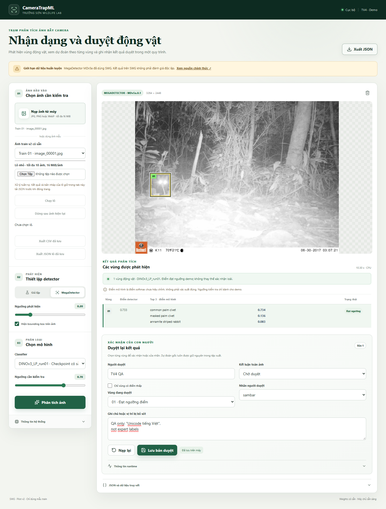
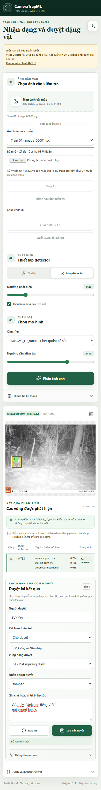
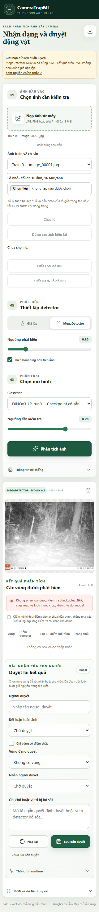

# TV4 W5 — DINO candidate, batch/CSV and UI-A11Y-01

Ngày 02/11/2026; branch `feat/demo`, nền `fef2511`. TV4 đã thực hiện integration
smoke; **chờ TV2 kiểm tra chéo và nhóm quyết định ứng viên demo**. B2 vẫn là
backend mặc định. Không merge PR, train model hoặc chạy official Test W4/W6.

## Tiếp nhận và thay đổi

- ZIP TV3 81,225,769 bytes; SHA-256 `9e969585cd7c7355733976b37bda912dd8deb2667d096ddf9193d62bbc276301`.
- Manifest 27/27 payload files khớp hash/bytes. Checkpoint thật 86,851,958 bytes;
  SHA-256 `acbe32252af4db420b7d6be4124b5273eadd81fff59620678d1f472413c0fbc3`.
- TV3 source `aa64fd7661827af78ddec4e3e0155b2b9c87b9e2`, report `5734d38c3af2fe052cf04c4c33d940e8f186306d`;
  tài liệu TV2 đọc từ `origin/feat/baseline` tại `df31029`.
- `src/training/dino_probe.py` là source TV3 nguyên byte, SHA
  `8529891d6cd213f4cc186de104b31d58d539782e2003fa6c475eb4000cdcb988`.
  Không merge toàn bộ nhánh TV3/TV2; chỉ đưa native interface cần thiết vào nhánh TV4.
- `src/demo/dino.py`: opt-in qua hai CLI flags, xác minh checkpoint/source/vendor
  cả khi warm, `weights_only=True`, strict load qua native, frozen/eval,
  CLS384+Linear8, FP32, RGB/no EXIF, square256 tensor-uint8 bilinear antialias,
  crop geometry dùng hàm hiện có, batch crop≤8, top3 riêng từng detection, tie ID nhỏ nhất.
- Schema giữ version và trường cũ, enum classifier thêm `DINOv3_LP_run01`.
  Đây là thay đổi additive cần TV2 review; không mở lỏng validation dữ liệu.
- Runtime phiên DINO ghi input256 và CPU thay vì cố định224 của B2.
- UI-A11Y-01: `#export` có `aria-label="Xuất JSON phiên đã lưu"`, icon aria-hidden.
  Nút vẫn có accessible name khi phần chữ bị CSS ẩn ở mobile.
- Queue tối đa10 ảnh, tuần tự, dừng sau ảnh hiện tại/chạy tiếp, độc lập ảnh lỗi,
  ID riêng cho tên file trùng, bản nháp giữ theo ảnh. Mở mục lỗi ẩn preview cũ;
  mở lại kết quả phục hồi đúng mode/model/ngưỡng.
- CSV một dòng/box, ảnh lỗi/không box/chờ có dòng riêng; BOM UTF8, quoting,
  neutralize công thức Excel; lấy nhãn/revision đã lưu từ backend. JSON lô là
  wrapper mới `batch-demo-1.0`, chứa original/review/events đầy đủ từng phiên.

## Native–adapter equivalence

[Bằng chứng đầy đủ](evidence/native_adapter_equivalence.json): model thật, cùng
CPU/runtime, cùng crop và shape batch, hai lần nạp riêng native và adapter.

- RGB193×77, grayscale61×205, RGB8×8: logits finite[3,8], **torch.equal PASS,
  max absolute logit delta0**, không đổi prediction.
- Từng crop batch1: equality PASS. Batch9 chia8+1 đối chiếu native cùng shape:
  equality PASS. Không so shape khác rồi nới tolerance.
- Raster portrait100×240, hai detection geometry khác nhau: trả hai top3 riêng.
- Unit test tie và hai vector khác nhau chứng minh thứ tự top3 theo từng box.
- Gate thiếu package/checkpoint sai kích thước/vendor sai từ chối cả sau warm.
  Gate hash/source có trong adapter; checkpoint/source artifact pin không thay đổi.

Đây là kiểm integration bằng fixture, không replay đủ600ảnh/680crop validation
hoặc tái nghiệm thu GPU. Acceptance84.50%/macroF1 của TV2 vẫn là báo cáo TV2;
TV4 không tạo accuracy mới từ phép smoke này.

## Browser và regression

[Browser verification](evidence/browser_verification.json),
[final batch regression](evidence/batch_final_verification.json),
[full unittest log](evidence/full_tests.txt).

- **380/380 unittest PASS**,155.793s; riêng TV4 **47/47 PASS**.
- `validate_results.py`:6/6 ví dụ PASS; JS syntax và `git diff --check`:PASS.
- Edge1440×1100,390×844,320×740: không tràn ngang, box nằm trong ảnh, export
  accessible name tồn tại, không pageerror JavaScript.
- MegaDetector thật+DINO thật trên **ảnh train gốc**, ID
  `c7a284b5-8c29-11eb-beac-000d3a74c7de`, SHA
  `a4b7e3b86fedf28e173573ad34d416fa9a78f3ccb27800638a2a5fb3b7f77e3c`:
  một box, top3, giữ model/hash, sửa nhãn QA, save/reload/export đúng revision,
  original bất biến, HTTP409 khi revision cũ.
- Nhiều box UI dùng mock có nhãn rõ; native DINO nhiều crop kiểm riêng phía trên.
  Chưa dùng ảnh nhiều box detector thật để kết luận chất lượng nhiều cá thể.
- No detection và detector error dùng scenario mock; ảnh JPEG hỏng dùng decoder
  thật; checkpoint cố ý sai dùng server QA riêng tạo **classify error thật**,
  không detections một phần, không silent fallback B2.
- Lô good/corrupt/good hoàn tất3/3; duplicate name khác request ID; draft theo
  ảnh; CSV trước lưu loại bản nháp, sau lưu có revision/ghi chú đúng.
  CSV đọc lại qua Python csv PASS5 dòng (2box+error+2box), công thức được escape.
- Giới hạn11 ảnh bị từ chối và giữ lô cũ; stop sau ảnh đầu giữ2pending; resume
  hoàn tất. Các phiên QA tiếp tục nằm trên disk, không bị dọn/xóa.

Các nhãn người duyệt trong [phiên mẫu](evidence/dino_review_example.json) và
[JSON lô](evidence/batch_example.json) là **QA giả lập**, không phải adjudication
chuyên gia. [CSV lô mẫu](evidence/batch_example.csv) chỉ là view của phiên đã lưu.

## Hiệu năng thực tế và giới hạn đo

Máy TV4: Intel i5-12450H,12logical CPUs,RAM15.71GiB,Windows11;
Python3.12.5,torch2.8.0+cpu,torchvision0.23.0,Pillow12.2.0,MD10.0.25.
GPU RTX4050 hiện diện nhưng adapter này chạy **CPU**, không CUDA/AMP/TF32.
Image batch1, detector1280px, DINO256px, max crop batch8; warm4torch threads.

| Phạm vi | Cold | Warm mean | Warm p50 | Số lượt |
| --- | ---: | ---: | ---: | --- |
| Native adapter3fixture crops, gồm gates/checksum/load khi cold | 2.195s | 1.153s | 1.164s | 1cold+5warm |
| HTTP inference wall, cùng1ảnh train/1crop, MD+DINO | 50.771s | 11.781s | 11.134s | 1cold+3warm |
| Browser click→nút enabled, cùng ảnh trên | 51.256s | 12.299s | 11.627s | 1cold+3warm |

Không gộp các phạm vi. HTTP wall loại upload/preview/journal/browser theo
timing_scope của phiên. Cold MD được nạp trước DINO (DINO mới giới hạn4threads),
nên cấu hình thread cold ban đầu khác warm; chưa phải benchmark kiểm soát đồng nhất.
Các lượt smoke dùng số mẫu nhỏ, cùng một ảnh; không báo p95 như ước lượng ổn định.
Các tác vụ QA khác trên máy có thể ảnh hưởng số đo; không coi là cam kết latency.

Native runner ghi process_memory_bytes tại cuối: có current/peak RSS trên Windows;
đây là footprint tiến trình sau hai lần nạp model riêng để equivalence, không phải
VRAM hay isolated production model memory. Không dùng thời gian GPU TV2 làm UI latency.

## Cách chạy và điều kiện còn lại

Xem [hướng dẫn W5](../../docs/tv4_w5_demo.md) cho CLI/setup/QA. Binary/architecture
checkout/ảnh gốc chỉ nằm outputs/data local; không stage vào Git.

TV2 cần retest UI-A11Y-01, additive schema, per-box adapter, revision/export và
native equivalence đúng commit. Nhóm quyết định có chọn DINO làm demo hay không.
GPU demo adapter, full validation replay tại TV4, clean install/video/gói nộp W6
chưa thực hiện trong lượt này. Không có kết luận88%, calibration hay Test DINO.
Queue/bản nháp chỉ tồn tại trong tab; cần tải JSON trước reload/đóng trang.
