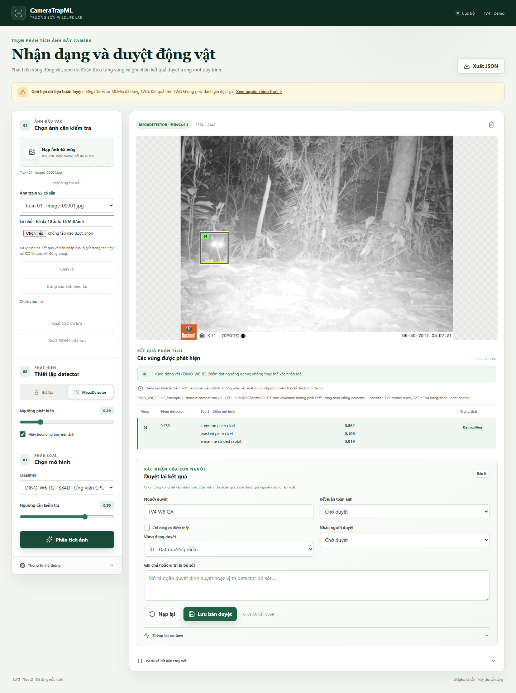
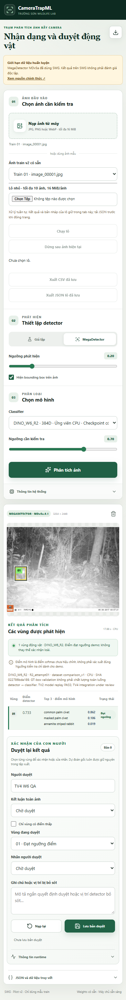
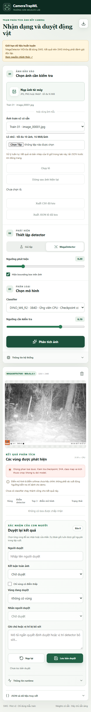

# TV4 W6 — R1-R4 integration và CPU benchmark

Ngày 08/11/2026; branch `feat/demo`, nền `cfcf006`.
Phạm vi chỉ R1-R4; R5/R6 chờ gói bổ sung theo yêu cầu TV4.
B2 giữ mặc định; DINO W5 dùng được qua loader/cache riêng.
Chưa merge vào main hoặc tự chọn checkpoint chính thức.

## 1. Intake, source và contract

- Bốn ZIP đã kiểm SHA/bytes, CRC, path/symlink/encryption/duplicate.
  Tổng145payload theo bốn receipt đều khớp; xem [intake](evidence/intake.json).
- Registry [demo_w6.json](../../configs/demo_w6.json) pin bốn checkpoint riêng,
  config raw/canonical, handoff/class map/preprocess/source-index SHA.
  R1 là768D CLS+mean patch, R2/R3/R4 là384D CLS với fine-tuned backbone.
- Native `src/training/dino_w6.py` giữ nguyên byte TV3:
  SHA256 `56f99e6ea2deed71f3281c531dc7d40a1a1e21f0d60faa8aae1c493ddb362fbc`.
  W5 loader SHA `8529891d6cd213f4cc186de104b31d58d539782e2003fa6c475eb4000cdcb988` không đổi.
- R1/R2 source commit `127cac5b64d37fdda630a2f84b006a8e420dc9ed`;
  R3/R4 `95652c2d770cac464633eef0149bd27f4d859ece`.
  Hai snapshot có cùng file inference SHA.
- Vendor clean tại `6876159a11b4df116f30f667f8c9888617df0751`.
  Full-backbone `TV3_DINO_W6_V1`, weights_only/strict load qua native TV3.
- CPU FP32, RGB/noEXIF, square256 uint8-bilinear-antialias rồi scale/normalize;
  crop cùng geometry detector/UI hiện có, không pad. Top3 riêng detection_id,
  tie lấy class ID nhỏ nhất. Ngưỡng demo0.70, không calibration/novel-species rule.
- Cache capacity1 candidate, identity gồm checkpoint/config/preprocess/source/device;
  package/source/vendor/checksum được kiểm cả khi warm. W5/B2 có cache riêng.
  Không fallback hoặc đổi device khi lỗi.
- CLI opt-in `--w6-registry configs/demo_w6.json`; không bật W6 trên đường chạy
  cũ nếu thiếu flag. UI ghi version/dataset/device/SHA và loại đánh giá.
- Schema chỉ thêm enum R1-R4 vào envelope hiện tại; CSV thêm các cột version,
  dataset/config SHA/pooling/dim/evaluation_type. Original/review/events giữ riêng.

TV2 hiện đã có replay PASS cho R1/R2 và R3/R4 trên nhánh baseline; các field
PENDING trong handoff gốc là trạng thái lịch sử của producer, không được sửa
nguyên bản để giả chữ ký. TV4 vẫn cần kiểm tra chéo tích hợp sau PR này.

## 2. Native–adapter equivalence

[Bằng chứng](evidence/equivalence.json), script
[verify_tv4_w6.py](../../scripts/verify_tv4_w6.py).
Model thật, load native riêng; cùng device/precision, crop và batch boundaries.

- Cả4 model: **torch.equal logits PASS, max_abs_delta0; softmax exact**.
- Batch9 chia8+1, batch1, crop thật từ ảnh train cùng RGB/grayscale fixtures.
- Portrait100×240 với hai detection trả hai top3 riêng; unit test dùng vectors
  khác nhau kiểm thứ tự per-box và tie rule.
- Cache swap R2→R1→R3→R4→R2 nạp lại đúng model; warm cùng identity tái sử dụng.
- Đây là CPU integration fixture, không replay600ảnh/680crop hoặc đo accuracy
  mới. Không lấy equality cùng CPU để tuyên bố cross-device GPU equality.

## 3. Benchmark CPU có kiểm soát

Chất lượng validation theo hồ sơ TV2/TV3 (600ảnh/680GTcrops), không tính lại
từ24ảnh train benchmark:

| Model | Seed | Validation accuracy | Macro-F1 |
| --- | ---: | ---: | ---: |
| W5/R0 | 42 | 84.5000% | 0.8444008279545706 |
| R1 | 42 | 83.5000% | 0.8338641693401928 |
| R2 | 42 | 85.1667% | 0.8506508530416190 |
| R3 (recipeR2) | 43 | 84.3333% | 0.8427567876976385 |
| R4 (recipeR2) | 44 | 85.1667% | 0.8506447651682460 |

Nguồn: [TV3 summary02](https://github.com/huyryan220806/Camera-Trap-ML/blob/61498e7/reports/tv3/w6/summary02.md),
[TV2 R1/R2 replay](https://github.com/huyryan220806/Camera-Trap-ML/blob/e5d550e/reports/tv2/TV2_W6_INDEPENDENT_MODEL_REPLAY_2026-11-06.md),
[TV2 R3/R4 acceptance](https://github.com/huyryan220806/Camera-Trap-ML/blob/e5d550e/reports/tv2/TV2_W6_R3_R4_INDEPENDENT_ACCEPTANCE_2026-11-07.md).
R1 không thắng W5; R3/R4 là seed lặp, không chọn seed cao nhất để thay headline.
Chưa có kết quả88% hoặc Test DINO độc lập trong hồ sơ này.

[Dữ liệu đầy đủ](benchmark.json), [24ảnh đã khóa](benchmark_images.json),
[hash cấu hình/source](configuration.json), [chỉ mục SHA](benchmark_index.json).
Log JSONL từng model nằm cạnh báo cáo, gồm envelope, box, top3, hash và lỗi.
benchmark_index chỉ liệt kê các output đo/config tại thời điểm publish;
REPORT và evidence bổ sung nằm ngoài chỉ mục đó.

Máy i5-12450H,12logicalCPU,RAM15.71GiB,Windows11;
Python3.12.5,torch2.8.0+cpu,torchvision0.23.0,MD10.0.25.
4torch threads,1interop thread,FP32/AMPfalse/TF32false/deterministic.
MDv5a.0.1,1280px; image batch1,crop microbatch8,classifier256px.
Không chạy GPU; không sử dụng ngân sách GPU2h hoặc booking.

Chọn trước đo bằng Random(42),3ảnh/lớp từ train pool đã sort image_id;
24ID duy nhất, SHA byte/RGB đều kiểm, không mở Test.
Thứ tự model W5→R2→R1→R3→R4; mỗi model process mới,
hai vòng warm24ảnh =48request/model, tổng240request warm.
Không gọi48request là48ảnh độc lập. P95 nearest-rank trên48lượt.

| Model | Dim | Cold classifier + 1 crop (s) | Pipeline mean (s) | p50 (s) | p95 (s) |
| --- | ---: | ---: | ---: | ---: | ---: |
| DINOv3_LP_run01 | 384 | 6.633 | 9.031 | 9.014 | 10.295 |
| DINO_W6_R2 | 384 | 8.394 | 8.147 | 8.807 | 9.732 |
| DINO_W6_R1 | 768 | 8.704 | 8.684 | 8.705 | 9.828 |
| DINO_W6_R3 | 384 | 8.871 | 8.991 | 8.996 | 10.669 |
| DINO_W6_R4 | 384 | 6.782 | 8.705 | 8.839 | 9.583 |

| Model | Detector mean (s) | Classifier mean (s) | Peak working set tiến trình (GiB) | needs_review / no_detection / ok |
| --- | ---: | ---: | ---: | --- |
| DINOv3_LP_run01 | 8.045 | 0.628 | 2.444 | 16 / 4 / 28 |
| DINO_W6_R2 | 7.218 | 0.574 | 2.719 | 10 / 4 / 34 |
| DINO_W6_R1 | 7.695 | 0.586 | 2.717 | 18 / 4 / 26 |
| DINO_W6_R3 | 8.029 | 0.582 | 2.710 | 14 / 4 / 30 |
| DINO_W6_R4 | 7.751 | 0.593 | 2.729 | 12 / 4 / 32 |

Mỗi model có50detection trên48request (25box/vòng),4no_detection
(tương ứng2ảnh/vòng), **không error thật trong bộ benchmark này**.
Không loại các ảnh no_detection/điểm thấp. Trạng thái đạt ngưỡng là score demo,
không phải người duyệt đã xác nhận hoặc accuracy train.

Cold classifier gồm gates/checksum+nạp weights+forward1crop train trong
process Python mới, sau import thư viện. Không cold boot/flushOS cache.
Cold detector request đo riêng với classifier đã nạp, lưu trong JSON.
Pipeline gồm decode+MD+classifier+schema, loại disk read/hash gate đầu vào,
HTTP/upload,preview,journal,browser và human review. Không gọi là UI latency.
Detector timer = MD adapter; classifier timer = crop/transform/gates/cache/forward.
Các thống kê classifier gồm lượt không box có classifier_ms0.

Peak working set là footprint toàn tiến trình có cả MD và classifier, không
phải RAM riêng model hoặc VRAM. Raw worker JSON giữ nguyên; helper runtime
legacy mặc định224 được ghi rõ và chuẩn hóa thành actual classifier_resolution256
trong benchmark.json; không sửa số đo thời gian.

Đây là một lượt benchmark theo thứ tự cố định trên workstation; biến thiên
clock/OS/cache/order có thể ảnh hưởng kết quả. MD chiếm phần lớn pipeline.
Không quy mọi chênh lệch thời gian cho recipe classifier, không cam kết latency.

## 4. UI, regression và lỗi

- **450/450 full unittest PASS**,241.283s:
  [full_tests02.txt](evidence/full_tests02.txt).
- 10/10test W6 mới PASS:[w6_tests02.txt](evidence/w6_tests02.txt).
  Lượt full đầu có2ERROR do fixture test mock thiếu class_map.json, đã bổ sung
  fixture và chạy lại. Giữ [log lỗi gốc](evidence/full_tests01_failed_fixture.txt);
  không đổi tolerance, native source hoặc gate để làm test qua.
- SyntaxJS,environment và6ví dụ core JSON PASS; diff-check PASS.
- [Browser QA](evidence/browser.json): real MD+R1/R2/R3/R4, top3 từng box,
  sửa/save/reload/export giữ original và model/hash, revision cũ trả409.
  B2 và DINO W5 vẫn chạy thật; default B2; không có option R5/R6.
- 1440×1100,390×844,320×740 không tràn ngang, overlay nằm trong ảnh;
  nút JSON giữ accessible name. Không có JavaScript pageerror.
- Lô R2 thật good/corrupt/good vẫn hoàn tất3/3, tên trùng có request riêng,
  bản nháp theo ảnh; mở ảnh lỗi không hiển thị preview cũ. CSV/JSON chỉ lấy
  review đã lưu, có version/dataset/config SHA; original bất biến.
- UTF8/quote/newline và escape công thức Excel được kiểm qua browser rồi
  Python csv roundtrip:3dòng cho good/error/good, đúng R2_attempt01/comparison_v1.
- No_detection/multiple/detector error và detector_miss dùng mock có nhãn rõ;
  decoder lỗi dùng JPEG hỏng thật. [Model-error UI](evidence/browser_errors.json)
  dùng registry QA riêng với checkpoint sai kích thước thật, trả classify error,
  không box/score một phần và không fallback. Không sửa weights thật để thử lỗi.
- 48paired request có detector geometry/score **giống chính xác giữa5model**;
  mỗi model giữ đủ4no_detection và50box. Benchmark không có model/detector error
  thật; lỗi được kiểm ở các case riêng, không tự gọi benchmark là bao phủ mọi lỗi.

Các JSONreview/[batch](evidence/batch.json), [CSV](evidence/saved.csv) và
[phiên lỗi model](evidence/model_error_session.json) chỉ phục vụ QA.

## 5. Hướng dẫn và bàn giao

[Chạy/test W6](../../docs/tv4_w6_demo.md), [progress](../../docs/progress_tv4_w6.md).
Binary,ZIP,ảnh và vendor checkout ở outputs/data local, không đưa vào Git.
Nhờ TV2 kiểm lại pin/cache/CPU equivalence, schema/CSV mới, revision và UI;
TV3 kiểm scores và native loader; TV1 đối chiếu24ảnh train.

Không thay mặc định sau một phép smoke. Chỉ nhóm quyết định sau review.
GT-box validation đã dùng chọn model, không phải detector end-to-end hoặc
Test độc lập; MD có SWG trong huấn luyện; score chưa calibration.
Các note/nhãn người duyệt trong evidence là **QA, không phải nhãn chuyên gia**.

R5/R6, GPU benchmark và checkpoint cuối cùng chưa thực hiện trong đợt này.
