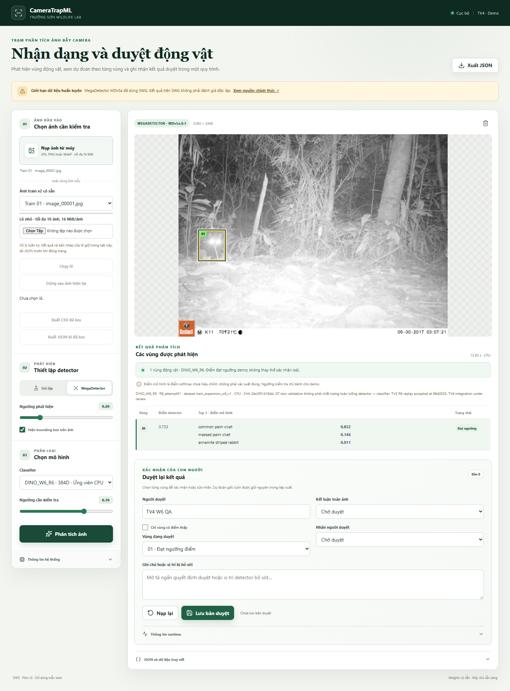
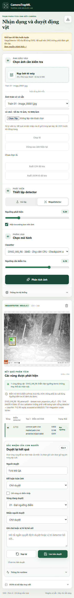
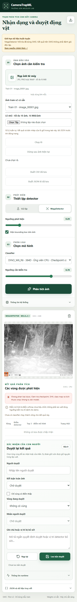

# TV4 W6 — bổ sung R6, 11/11/2026

R6 seed43 được tích hợp dưới dạng **ứng viên chọn tường minh**. B2 vẫn mặc định,
W5 và R1-R4 giữ được. R5 FAILED được bỏ qua theo yêu cầu TV4. Quyết định
checkpoint cuối và nghiệm thu tích hợp của TV2/TV3 vẫn là bước riêng của nhóm.

## Tiếp nhận và contract

[Intake](evidence/intake.json) xác nhận ZIP CRC/path, 36 payload và các SHA:

- ZIP: `fcb6118cd89c1a825d02e6d1c0a7bd19b983bac7bebaf863b959c0dd8854144e`, 267959559 byte.
- Best checkpoint: `24e3f51418dd7492a7537dff629794547c4540e8929bfe3e566105a6486581ef`, 86851190 byte.
- Config canonical: `08a01874ccc2cf0f21e652ed082893bfc666e4489c01e7b5cb36404bebe67a70`.
- Native source: `46e7a5364ad5685d84a3e48e7a6bffe1d9bfedba9547ac0037ce812dae6e79e9`,
  snapshot nguyên byte từ TV3 commit `3b4b106c01e64901f213f6eebfdd10ffa55a7eb7`,
  lưu riêng tại `src/training/dino_w6_r6.py`; native W5/R1-R4 không sửa.
- DINOv3 vendor clean, commit `6876159a11b4df116f30f667f8c9888617df0751`.
- CLS384, final2blocks/norm/head fine-tuned, 8 lớp; RGB uint8 bilinear antialias
  square256 → float32/ImageNet normalization. Dataset `train_expansion_w6_v1`;
  SHA `a6ac6933062b51280ad66dbca07853005007cc8da09848adcbe84ed83be9dda5`.

Registry opt-in `configs/demo_w6_r6.json` giữ 4 entry cũ và thêm R6, kiểm bytes,
checkpoint/config/mapping/preprocessing/source/handoff/vendor trước mỗi lần dùng.
R6 dùng native snapshot riêng có hỗ trợ cấu hình 3 giờ của producer. Không chạy
training/resume. Cache capacity1, identity gồm weights/config/preprocess/source/
vendor/device; lỗi báo rõ, không silent fallback. Original registry chỉ R1-R4.
UI và CSV ghi đúng `R6_attempt01` và dataset mở rộng; schema thêm ID R6, không R5.

TV2 đã nghiệm thu **model replay**, commit
[`96d2025`](https://github.com/huyryan220806/Camera-Trap-ML/blob/96d202563c63b47d4d3d6773c3d4b5a2a29c3c7a/reports/tv2/TV2_W6_R6_INDEPENDENT_MODEL_REPLAY_2026-11-10.md):
519/600 GT-box validation images, accuracy **86,50%**, macro-F1
**0,8641867348386344**, exact GPU replay. Đây là kết quả TV2, không phải accuracy
TV4 đo lại, không phải detector end-to-end hoặc Official Test. So với R0/W5
84,50%, khác cả tập train; chưa đạt KPI88% và không suy ra cải thiện nhân quả.

## Native–adapter equivalence

[Bằng chứng logits đầy đủ](evidence/equivalence.json): R6 và R2 đối chiếu
`load_package`/`predict_crops` native với adapter trên **cùng CPU/runtime/batch**,
crop train thật và RGB/grayscale fixtures, batch8+1, batch1, portrait2box/top3
riêng mỗi box. Logits và softmax khớp tuyệt đối, **max delta0**, không nới tolerance.
Warm cache và đổi sang R1 rồi quay lại R6 phải reload: PASS. Không khẳng định
CPU logits bằng GPU hoặc tái kiểm định toàn bộ 600 validation images.

## Chi phí thực tế

[Benchmark](benchmark.json), [raw logs/index](benchmark_index.json),
[cấu hình và source hashes](configuration.json), [fixture khóa](benchmark_images.json).
Giữ nguyên báo cáo [R1-R4 trước đây](../tv4_w6/REPORT.md); đây là đợt đo mới riêng.

- Máy i5-12450H, RAM15,71GiB, Windows11, Python3.12.5, torch2.8.0 CPU,
  torchvision0.23.0, Pillow12.2.0, MegaDetector10.0.25. FP32, AMP/TF32 tắt,
  deterministic, 4threads/1interop. GPU dùng **0 giờ**.
- Cùng 24 ảnh train, 3/lớp, seed42; fixture SHA
  `d2b0f1d6b05a02a3a192c5748099a76f9bfb4688ef49c887be1a2758726f4077`.
  Hai vòng warm =48 request/model, **144 request**, không phải144 ảnh độc lập.
- MDv5a.0.1, resize1280, threshold0.20, review0.70; classifier256, imagebatch1,
  crop microbatch8. Hash detector/runtime đầy đủ trong JSON.
- Fresh Python riêng mỗi model; cold classifier gồm gates/load+1GTcrop;
  cold pipeline đo request detector đầu tiên khi classifier đã load.
- Pipeline gồm decode/detector/classifier/checksum-cache/schema; loại disk input
  read/hash gate, HTTP/upload, preview, journal, browser và người duyệt.

Đơn vị giây, warm **mean / p50 / p95** (p95 nearest rank, n48):

| Model | Pipeline | Detector | Classifier | Cold classifier+crop | Cold pipeline | Peak process GiB |
| --- | --- | --- | --- | ---: | ---: | ---: |
| W5 | 6.482 / 4.433 / 11.601 | 5.805 / 3.837 / 10.616 | 0.464 / 0.376 / 0.867 | 6.610 | 37.235 | 2.236 |
| R2 | 7.529 / 8.592 / 12.247 | 6.766 / 7.327 / 11.697 | 0.501 / 0.404 / 0.935 | 3.036 | 7.416 | 2.730 |
| R6 | 10.961 / 10.315 / 13.591 | 9.837 / 9.255 / 12.403 | 0.732 / 0.734 / 1.055 | 6.956 | 22.424 | 2.712 |

Mỗi model giữ 4no_detection và50box, không lỗi inference; W5:28ok/16needs_review,
R2/R6:34ok/10needs_review. Các trạng thái review không phải nhãn đúng/sai.
[48/48 cặp](evidence/paired_detector.json) có cùng ID ảnh/hash/round và detector
geometry/scores giữa cả3model. Không bỏ ảnh không phát hiện hay điểm thấp.

Đo tuần tự W5→R2→R6 trên laptop, không randomize thứ tự/khóa nhiệt độ hoặc power
state; detector và timing dao động rõ. Không dùng các mean này để khẳng định
R6 chậm hơn do kiến trúc hoặc ngoại suy GPU. Không chạy thêm inference/test
trong benchmark. Runtime helper cũ ghi default224; bản tổng hợp ghi đúng actual
transform256 và giữ nguyên raw JSON cùng trường/note giải thích chuẩn hóa.
Index chỉ hash các file benchmark tại lúc publish; evidence/report bổ sung sau.

## Hồi quy, UI và bàn giao

Kết quả chi tiết và ảnh chụp được lưu trong `evidence/`. Nhãn/ghi chú người duyệt
ở đây chỉ phục vụ QA, không phải nhãn chuyên gia. Model/detector error được
kiểm bằng case riêng, không gọi benchmark thành công là đã bao phủ mọi lỗi.

- [60/60 kiểm thử liên quan](evidence/focused_tests.txt) PASS; environment pins,
  sáu JSON examples và JS syntax PASS.
- [453/453 full regression](evidence/full_tests.txt) PASS trong240,408s.
  Suite cũ có synthetic smoke training trên dummy data; không huấn luyện lại
  model đồ án hoặc chạy Official Test.
- [Edge browser](evidence/browser.json) PASS: real R6 một box/top3, B2/W5 chạy
  được và B2 mặc định; sửa/lưu/reload/export, original bất biến, revision409.
- 1440×1100,390×844,320×740 không tràn ngang/pageerror, box trong ảnh; nút
  JSON có accessible name. Đã xem ảnh chụp desktop/mobile.
- Lô R6 thật good/corrupt/good, tên trùng/request riêng, bản nháp tách theo ảnh,
  preview lỗi không giữ ảnh cũ; CSV/JSON chỉ xuất review đã lưu.
- [CSV roundtrip](evidence/csv_roundtrip.json):3dòng good/error/good, đúng version/
  dataset, UTF8/quote/newline và escape công thức. [CSV](evidence/saved.csv),
  [batch JSON](evidence/batch.json), [review](evidence/R6-review.json).
- Multiple2box/no_detection/detector error/miss dùng mock có nhãn rõ; ảnh hỏng
  thật kiểm decoder. [Checkpoint lỗi kích thước thật](evidence/browser_errors.json)
  dùng registry QA riêng, không sửa weights thật: classify error, classifier
  provenance null, không box một phần hoặc fallback; [phiên](evidence/model_error_session.json).

Giới hạn giữ nguyên: MegaDetector đã dùng SWG, GT crop khác detector crop,
softmax chưa calibration, validation đã dùng chọn model. Không mở Official
Test W4; không train lại, sửa weights, đổi default hoặc merge thay nhóm.

[Hướng dẫn chạy/kiểm thử](../../docs/tv4_r6_demo.md),
[tiến độ và bàn giao](../../docs/progress_tv4_r6.md).
Nhờ TV2 kiểm pin/cache/equivalence/review-export; TV3 kiểm scores/native;
TV1 xác nhận dataset/fixture. Chờ nhóm chốt checkpoint demo.
